<p align="center">
  <a href="README.md">简体中文</a> · <b>English</b> ·
  <a href="README.es.md">Español</a> · <a href="README.ja.md">日本語</a> · <a href="README.ko.md">한국어</a>
</p>

<p align="center"></p>
<h1 align="center">AENHT</h1>
<p align="center">
  <b>All E-Hentai + nhentai HenTai</b><br>
  An unofficial client for browsing nhentai and E-Hentai / ExHentai in one app<br>
  Native iPhone / iPad UI with SwiftUI, native Android UI with Jetpack Compose, and a shared Kotlin Multiplatform core
</p>
<p align="center">
  <a href="https://github.com/AtlanYuey/AENHT/releases/latest">Stable release</a> ·
  <a href="https://github.com/AtlanYuey/AENHT/releases/tag/dev-latest">Latest revision</a> ·
  <a href="#features">Features</a> · <a href="#design">Design</a> ·
  <a href="#usage">Getting started</a> · <a href="#build">Build</a>
</p>

> [!WARNING]
> Current version: 0.2.5. The project is actively developed. For adults aged 18 and over only.
> This project is not affiliated with nhentai or E-Hentai.

<p align="center">
  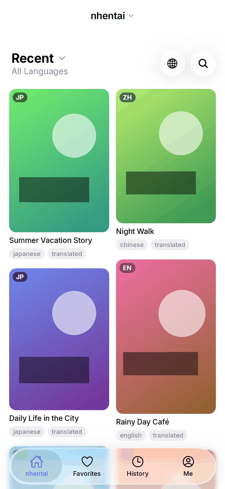
  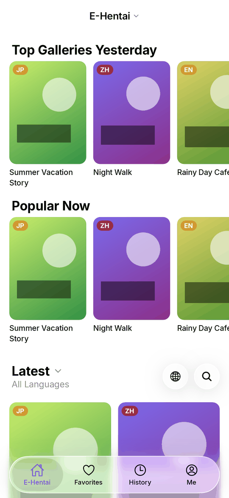
  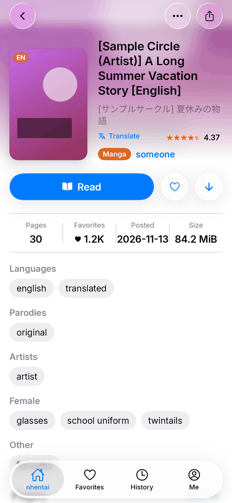
  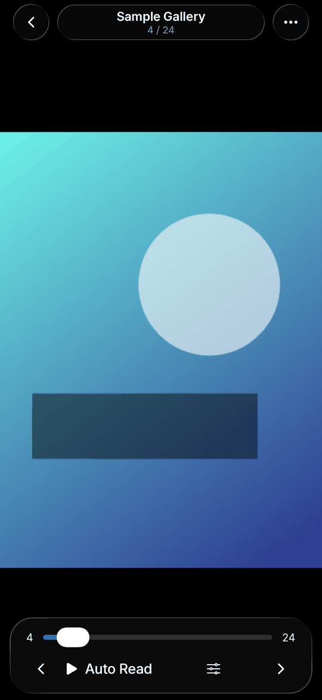
</p>
<p align="center"><sub>Screenshots are from Android interface tests, using sample covers and titles. The iOS app follows the same general layout.</sub></p>

## Why AENHT?

Using separate apps for nhentai and E-Hentai means separate favorites, histories, and settings. AENHT brings both sites together:

- **One interface for two sites:** home, search, gallery details, and the reader use a consistent structure.
- **Combined favorites, history, and downloads:** items from both sites appear together, with site badges and optional site filters.
- **Native interfaces:** SwiftUI on iOS, including Liquid Glass on iOS 26, and Compose on Android.
- **A shared core:** networking, parsing, database logic, synchronization, translation, and rate limiting use Kotlin Multiplatform.

<a id="features"></a>
## Feature overview

| | nhentai | E-Hentai / ExHentai |
| --- | :---: | :---: |
| Home feeds | Latest; popular today / week / month / all time | Latest, popular, watched; four toplists |
| Pinned recommendations, up to two rows | ✅ | ✅ |
| Search, tag syntax, shared search history | ✅ | ✅ Syntax conversion when switching sites |
| Open by number or pasted link | Gallery number | Gallery link |
| Details, tags, page thumbnails, comments | ✅ | ✅ Also ratings, torrents, archives |
| Other languages and editions | ✅ | ✅ |
| Similar galleries | ✅ | ✅ |
| Account favorites synchronized locally | ✅ | ✅ Ten favorite folders and notes |
| Comments | Post | Post, vote, block commenters |
| Accounts | Login, API key, multiple accounts | Web login, cookies, ExHentai access, multiple accounts |
| Site-side blocking | Account tag blacklist | My Tags website page |
| Downloads | ✅ | ✅ Also original images and official archives |
| Tag voting / adding tags | — | ✅ |
| Image quota and GP | — | ✅ |

Features shared by both sites:

- **Reader:** reading directions, double pages, automatic cropping, automatic page turns, continuous auto scrolling with adjustable speed, super-resolution, tap zones, gestures, keep-awake, brightness, grayscale, and inversion.
- **Tablets:** Tablet Layout settings for the home page, gallery pages and Me in landscape, on iPad and Android tablets.
- **External devices:** Apple Pencil (double-tap, squeeze), Android styluses including Galaxy S Pen Air actions, Windows pens such as Surface Pen, and keyboards or Bluetooth page turners turn pages; their settings appear once a device is connected or used.
- **Translation:** Chinese tag translations; titles and comments through AI services, Microsoft Translator, or on-device translation.
- **Filtering:** shared tag, title, and regular-expression rules.
- **Sync:** WebDAV between iOS and Android, plus iCloud settings sync on iOS.
- **Privacy:** app lock, background privacy modes, and diagnostic logs.
- **Interface languages:** 14.

## Screenshots

<table>
  <tr>
    <td align="center"><br><sub>nhentai home</sub></td>
    <td align="center"><br><sub>E-Hentai home and toplists</sub></td>
    <td align="center">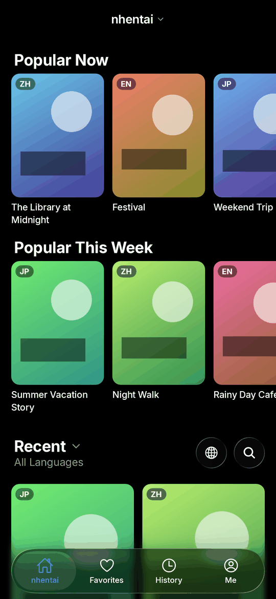<br><sub>Dark mode and pinned rows</sub></td>
    <td align="center">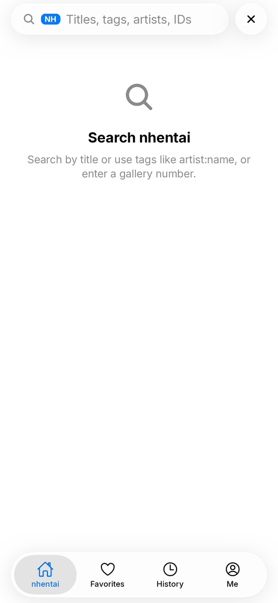<br><sub>Search</sub></td>
  </tr>
  <tr>
    <td align="center">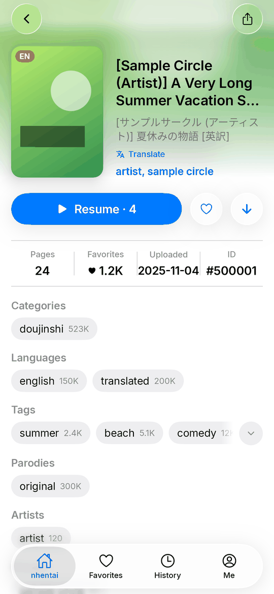<br><sub>nhentai details</sub></td>
    <td align="center"><br><sub>E-Hentai details</sub></td>
    <td align="center"><br><sub>Reader</sub></td>
    <td align="center">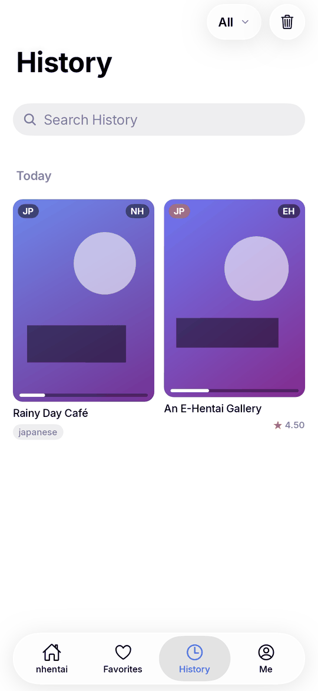<br><sub>Combined history</sub></td>
  </tr>
  <tr>
    <td align="center">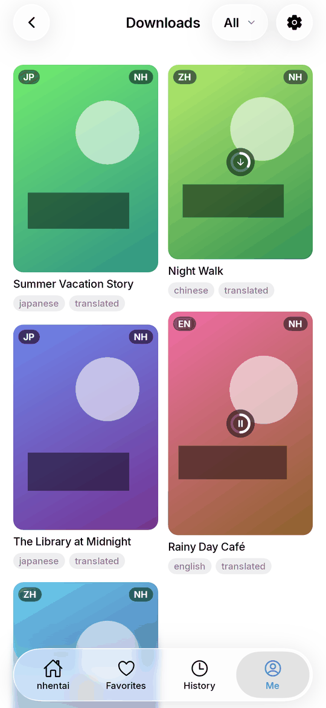<br><sub>Downloads</sub></td>
    <td align="center">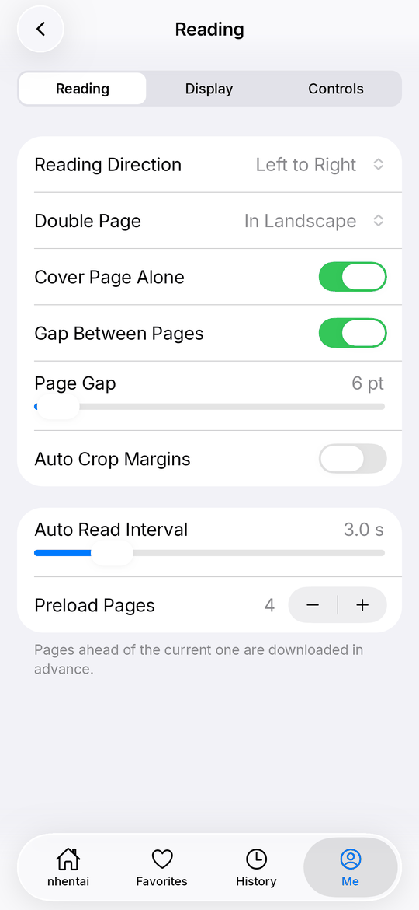<br><sub>Reading settings</sub></td>
    <td align="center">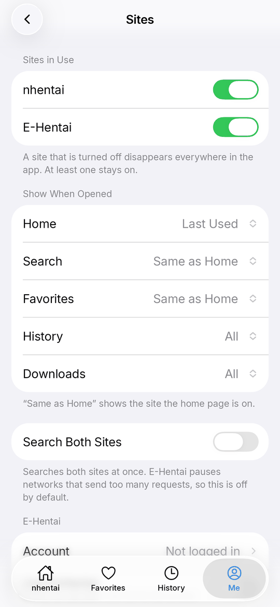<br><sub>Site settings</sub></td>
    <td align="center">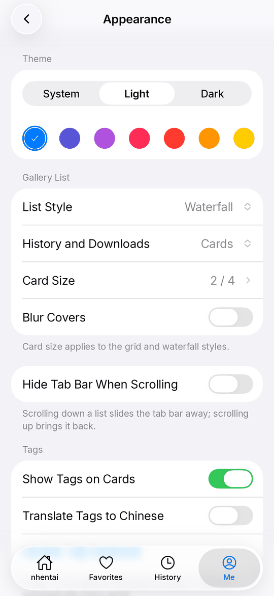<br><sub>Appearance</sub></td>
  </tr>
  <tr>
    <td align="center">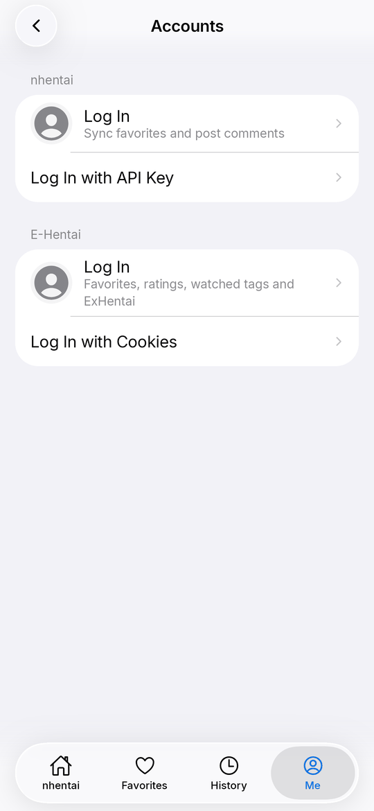<br><sub>Accounts</sub></td>
    <td align="center">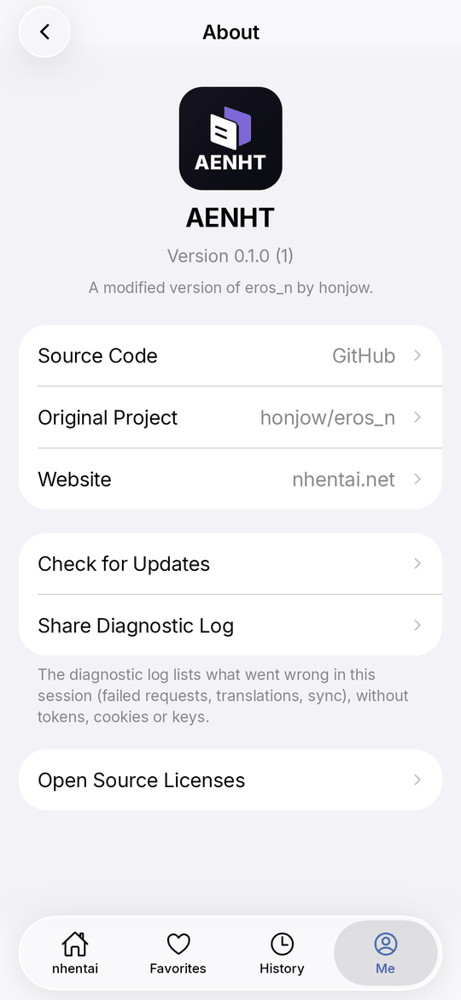<br><sub>About</sub></td>
    <td align="center" colspan="2">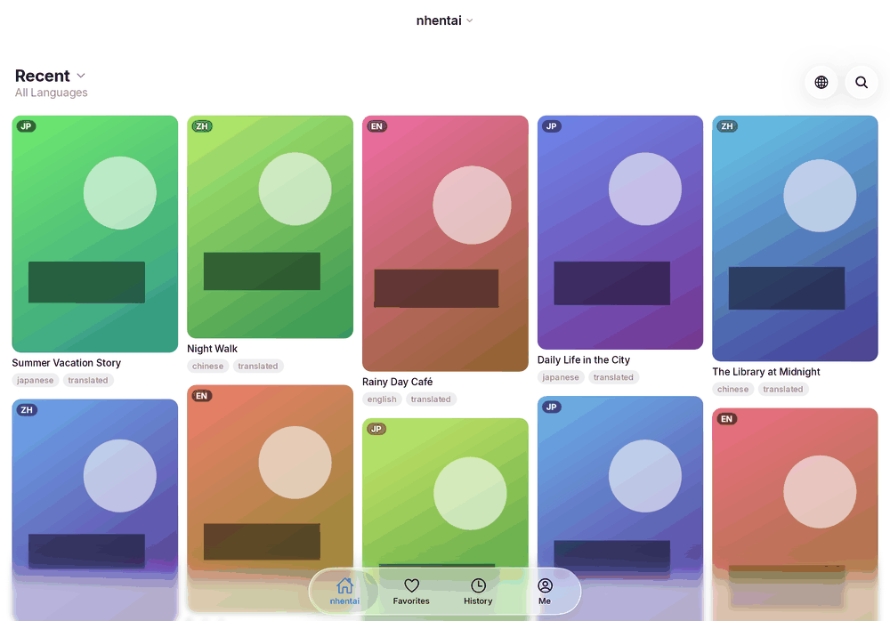<br><sub>Tablet landscape layout</sub></td>
  </tr>
</table>

<a id="design"></a>
## Design

### 1. One app, two sites, one interface

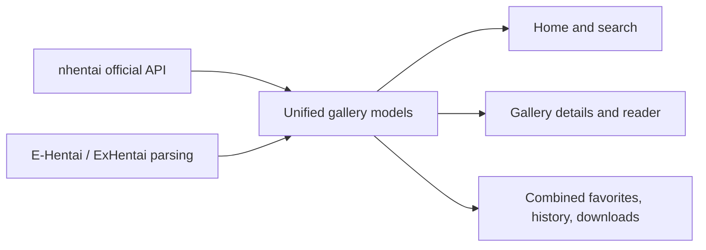

Site data is converted into common gallery models. Both detail pages follow the order information → tags → pages → other editions → similar galleries → comments. Site-specific functions, such as E-Hentai ratings, torrents, and archives, stay in suitable places within that structure.

- ExHentai is an E-Hentai option, not a third independent site. Its switch is next to E-Hentai under **Me › Sites**, and appears when E-Hentai is enabled. Covers carry an EX badge.
- Each site-aware page can start with the last selection, the home selection, nhentai, E-Hentai, or all sites. These defaults are grouped under site settings.
- Card language badges appear at the top left; colors follow gallery categories consistently across sites. Combined lists show NH or EH at the top right.

### 2. A compact header

- The centered site name is a glass button for switching sites. With only one site enabled, its arrow is hidden.
- The top-right dice button opens a random nhentai gallery.
- Below it, the sort menu shows the current order and language, with separate language and search buttons.
- While scrolling down, sorting, language, and search move into the top bar; returning to the top restores them.
- Header controls are white in dark mode and black in light mode. Search expands in place, with the site selector below it.
- The favorites title is itself a menu for choosing all sites, a site, or an E-Hentai folder.

### 3. Tab-bar tap behavior

| Action | Home / Favorites / History | Me |
| --- | --- | --- |
| Tap | Scroll to the top | Go back one level |
| Tap again | Return to the previous position | Go back another level |
| Quick double tap | Refresh | — |

The gallery's **Pages** heading similarly switches between the first page and the previous position. On iPad, the tab bar can follow the last touched side, with three movement speeds, or stay fixed left, center, or right.

### 4. Reader transitions and tablet layouts

- Opening a thumbnail expands it into the reader; closing returns to the thumbnail of the **current page**, centering that page in the thumbnail row.
- Tap zones and swipe gestures work together. With left/right tap zones, vertical gestures can exit, show controls, or toggle auto reading; with top/bottom zones, those gestures move to the horizontal axis. Swipes along the reading direction remain page turns.
- Keep-awake defaults to five minutes from the last touch, then hands control back to the system's auto-lock. It does not lock earlier than the system.
- Double pages use a 6 pt center gap by default. Page-spacing settings apply only to continuous reading with gaps.
- In tablet landscape, gallery information and pages sit side by side, home recommendations form two columns, and **Me** uses a two-pane layout. The overview includes accounts, downloads, history and favorite counts, sync, and version information. Split covers keep rounded corners; iOS 26 adds soft gradient blur. Each part can be turned off in **Me › Tablet Layout**; the gallery page's right half shows the pages (half the page or three narrow columns) or other versions, similar galleries and comments, and the pages pane follows the page being read.
- Rotation preserves the visible card while relaying out the list. iOS gallery lists use UICollectionView.

### 5. Super-resolution when needed

Real-ESRGAN anime models run locally through Core ML on iOS and ncnn on Android. The original appears immediately and is replaced when processing finishes. Automatic mode targets images noticeably smaller than their display area. When super-resolution is enabled, the visible page has priority and eligible upcoming images can be processed in advance. A default model is bundled, with higher-quality models available in settings.

### 6. Translation fallbacks

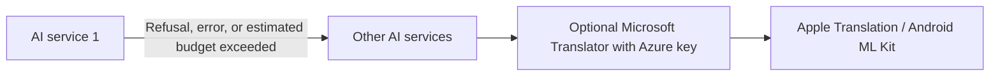

AI service settings follow [AY Translate](https://github.com/AtlanYuey/AY_Translate): DeepSeek, Gemini, OpenAI, Qwen, SiliconFlow, Kimi, Zhipu, OpenRouter, and custom OpenAI-compatible services. Pasting a key loads the model list. Services support a test phrase, parameter presets or custom JSON, unit prices, and an estimated monthly spending limit. Keys remain in local keychain or encrypted storage. A notification names the service when a fallback occurs.

Translated titles replace the original until tapped again. Tag translation uses EhTagTranslation's Chinese database, updates weekly, and also applies to tags on home cards.

### 7. Respecting site limits

Each site has a global rate limiter, based on nhentai API limits and E-Hentai request limits. Long waits show a countdown. Rate limiting cannot be disabled, helping avoid E-Hentai IP blocks. Searching both sites at once is off by default. Download concurrency, retries, and per-page delays are configurable; E-Hentai downloads at most three pages concurrently.

### 8. Privacy levels

The app switcher can blur images only, blur images and text, blur the whole app, or cover the app with a solid color. Image-only blur is the default; the image-and-text option leaves settings controls readable. App lock supports Face ID, Touch ID, fingerprints, and device credentials. Covers can also remain blurred while using the app.

## Feature details

<details>
<summary><b>Home and search</b></summary>

- nhentai: latest and popular today, this week, this month, or all time. E-Hentai: latest, popular, watched, and yesterday/month/year/all-time toplists.
- Up to two pinned recommendation rows load and appear together. Defaults are current popular + weekly popular for nhentai, and yesterday's toplist + current popular for E-Hentai.
- Masonry, compact masonry, grid, and list layouts; independent portrait and landscape card sizes; column counts adapt to split-screen and Stage Manager.
- Optional translated tags on cards, language filters, and the nhentai random button.
- Search normally uses the current site; searching both is optional. Switching sites converts supported query syntax and marks unsupported conditions.
- A number offers the matching nhentai gallery above normal results; an E-Hentai / ExHentai link offers that gallery. Returning to the app can prompt to open a clipboard gallery link.
- Local tag completion and shared search history with site labels; history saving can be disabled.
</details>

<details>
<summary><b>Gallery details</b></summary>

- Cover, translated and original titles, authors, category, and E-Hentai rating controls. Read or resume at a page, favorite, and download.
- Information includes page count, favorites, publication date, size, or gallery number.
- Namespace-grouped tags: tap to search, long press to copy. E-Hentai also supports voting and adding tags.
- Thumbnails, a Pages heading that toggles between the start and previous position, and an All button on the right.
- Other languages/editions and related galleries. nhentai uses official recommendations; E-Hentai tries artist/group, parody + character, then theme combinations.
- Both sites support posting comments. E-Hentai adds voting, copying, and blocking commenters. Comments can be translated and filtered.
- E-Hentai also provides favorite folders and notes, torrents, official archive downloads that spend GP, and opening in the browser.
</details>

<details>
<summary><b>Reader</b></summary>

- Left-to-right, right-to-left, top-to-bottom, continuous Webtoon, and continuous reading with adjustable gaps.
- Double pages in landscape or always, a separate cover, optional one-page advances through spreads, and an optional center gap: 6 pt by default, adjustable from 2–60 pt.
- Automatic white-border cropping, adjustable automatic page-turn intervals, and preloading of following pages.
- Continuous auto scrolling with adjustable speed. At three seconds per screen or faster, the speed warning turns red. **Continue Auto Scroll While Dragging** is below the speed control and off by default.
- The reader decodes the next two images below the screen in continuous mode, or the next two turns in paged mode (up to four images with two-page spreads). This runs by default. The preload page count separately controls how many pages are downloaded ahead.
- Swipe to Turn: slide, or Swipe Fade (the page stays and a soft fade edge follows the finger; drag back to cancel). Tap to Turn: slide, Page Fade, or Spread Fade (spreading from where you tapped).
- Page size: pinch to enlarge and move the page with one finger (with momentum); an enlarged page doesn't turn or close, and Reset Size appears at the bottom. Paged modes can allow pages smaller than the screen. Continuous reading shows a whole page's width by default; pinch to change it, and Keep Page Size remembers it.
- Double-tap the title at the top to go to the first page; a tap on the status bar does nothing in the reader.
- Apple Pencil (iPad): double-tap or squeeze (Pro), held away from the screen; the pencil's generation is inferred from the iPad model and the gestures received. Android styluses: configurable pen, second and tail buttons; Galaxy S Pen Air actions. Windows pens (Surface Pen): the top button. Keyboards and Bluetooth page turners: arrows, Page Up / Down and Space (a screen at a time in continuous reading).
- Left/right or top/bottom tap zones; long perpendicular swipes can exit, toggle controls, or start/stop auto reading. Pinch and double tap zoom the page.
- Keep-awake: off, five minutes, ten minutes, or always. Super-resolution: off, automatic, or always, with downloadable higher-quality models.
- Page-only brightness, grayscale, and inversion; jump to a page, save or share one page; Android volume-key page turns.
- Controls hide after inactivity. The control bar is one row (the page, the slider, the pages left); dragging the slider previews the pages around it. Reader Settings and Auto Read float on the sides (one alone follows your hand); the controls can also be set to show only from a tap in the middle. Settings are grouped into Reading (direction, page turns, auto read, preload), Display (filters, page size, super-resolution, keep-awake), and Controls (control bar, taps and swipes, keys and devices).
</details>

<details>
<summary><b>Favorites, history, and downloads</b></summary>

- Account favorites are copied locally and combined by favorite time for offline browsing. nhentai supplies no favorite timestamps: the initial order is preserved, and newly discovered favorites receive timestamps afterward.
- Filter favorites by site or E-Hentai's ten folders, choose which folders appear under All, and search favorites. Favorite/unfavorite actions roll back if the request fails. Favorites reload when their tab is opened (unless scrolled down). Select several to remove them, on the site too.
- Combined history is grouped by date, with site filters, search, reading progress, and multi-select deletion.
- Downloads from both sites are grouped by status, with multi-selection, pause, resume, deletion, and CBZ export through sharing or the file/download folder.
- Configure concurrent galleries/pages, retries, page delays, and original-image downloading. History and downloads offer card and list layouts.
</details>

<details>
<summary><b>Accounts and filtering</b></summary>

- Multiple accounts per site, switched by tapping; E-Hentai uses an EH letter avatar.
- nhentai supports account or API-key login and the account's tag blacklist.
- E-Hentai supports web or manual-cookie login, including `igneous` for ExHentai, access checks, image quota and GP costs, and links to site settings and My Tags.
- Shared filtering rules match tags, titles, or regular expressions. Tag rules ignore namespaces, allowing nhentai `tag:` and E-Hentai `female:` / `male:` matches.
- Matched galleries are hidden from both home and search. The nhentai account blacklist provides an additional layer. Blocked commenters are hidden across galleries.
</details>

<details>
<summary><b>Sync, backups, and other settings</b></summary>

- WebDAV syncs settings, history, and favorite copies between Android and iPhone. Nextcloud, NAS servers, and Jianguoyun with an app password are supported, with optional sync on opening/backgrounding.
- With server ETag support, uploads check for concurrent changes and merge before retrying. Persistent conflicts ask you to retry later instead of overwriting. Servers without ETags lack this protection; avoid simultaneous sync there.
- Synchronized favorite copies stay hidden until this device has fully fetched the signed-in account's website favorites, preventing another account's copies from appearing.
- iCloud synchronizes iOS settings through the Apple account. Share across iPhone/iPad or only the same device category; column-count sync is optional.
- Export/import settings as a file. Android system backup includes settings only. History and favorite copies rely on WebDAV; downloaded files stay local.
- Check the latest release and development build. Diagnostic logs cover failed requests, translation, and sync in the current session, removing recognized token, cookie, key, and password formats. Review before sharing.
- System/light/dark appearance, accent colors, and optional collapsing top/bottom bars, including a compact bottom button.
- App-specific language selection: Simplified/Traditional Chinese, English, Japanese, Korean, Spanish, French, German, Italian, Brazilian Portuguese, Russian, Vietnamese, Thai, and Indonesian.
</details>

<a id="usage"></a>
## Getting started

### Installation

Get stable builds from [Releases](https://github.com/AtlanYuey/AENHT/releases/latest), or the rolling build from [dev-latest](https://github.com/AtlanYuey/AENHT/releases/tag/dev-latest). **About › Check for Updates** links to both.

| Platform | File | Requirements |
| --- | --- | --- |
| Android | `.apk` | Android 10 or later |
| iPhone / iPad | `.ipa` | iOS / iPadOS 18 or later; 26 recommended |

Install the Android APK directly. Release APKs use a consistent signing certificate for in-place upgrades; test builds older than 0.1.0 require one uninstall first. Public iOS IPAs are unsigned: use your own Apple ID with AltStore, SideStore, Sideloadly, or a similar tool.

### First launch

1. Home initially opens nhentai. Tap the site name at the top to switch to E-Hentai.
2. Choose enabled sites and page defaults under **Me › Sites**.
3. Login is optional for browsing, searching, reading, and downloading. Account favorites, comments, and ExHentai require login.
   - nhentai: **Me › Accounts › nhentai › Log In**, or create a key under nhentai.net › Settings › API Keys and choose API-key login.
   - E-Hentai: **Me › Accounts › E-Hentai › Log In**. If web login fails, copy `ipb_member_id`, `ipb_pass_hash`, and, for ExHentai, `igneous` from a logged-in browser, then choose cookie login: the copied text is recognized and filled in (a Cookie header, a cookie extension's JSON export or cookies.txt; copy them all at once).
   - With ExHentai access, enable its switch under the E-Hentai account or site settings.

### Translation and sync setup

- Chinese tag translation: **Appearance › Translate Tags to Chinese**.
- Titles/comments: **Me › Translation › Add AI Service**. Choose a provider, paste a key, wait for models, test translation, and drag services into the desired fallback order.
- Without a key, on-device translation is used. First use downloads language packs; iOS prompts through the system, and Android packs are about 30 MB per language.
- WebDAV: **Me › WebDAV Sync**, enter server URL and credentials, then connect. Data is stored in the server's `AENHT` folder.
- iCloud: **Me › iCloud Sync**. Signing must include the iCloud capability; sideloaded signatures often do not. Settings file export/import is an alternative.

### Gesture reference

| Location | Action | Result |
| --- | --- | --- |
| Tab bar | Tap / tap again / quick double tap | Top / previous position / refresh |
| Gallery Pages heading | Tap / tap again | First page / previous position |
| Translated title | Tap | Switch translated/original title |
| Tag | Tap / long press | Search / copy |
| E-Hentai comment | Long press | Vote, copy, block |
| Reader | Tap zones / center | Turn page / show controls |
| Reader | Long perpendicular swipe | Configured exit, controls, or auto reading |
| Reader | Pinch / double tap | Zoom |
| Reader | Double-tap the title | First page |
| Reader (iPad) | Apple Pencil double-tap / squeeze | Next / previous page (configurable) |
| Reader | Keyboard or page turner: → ↓ Space / ← ↑ | Next / previous page |

## Project structure

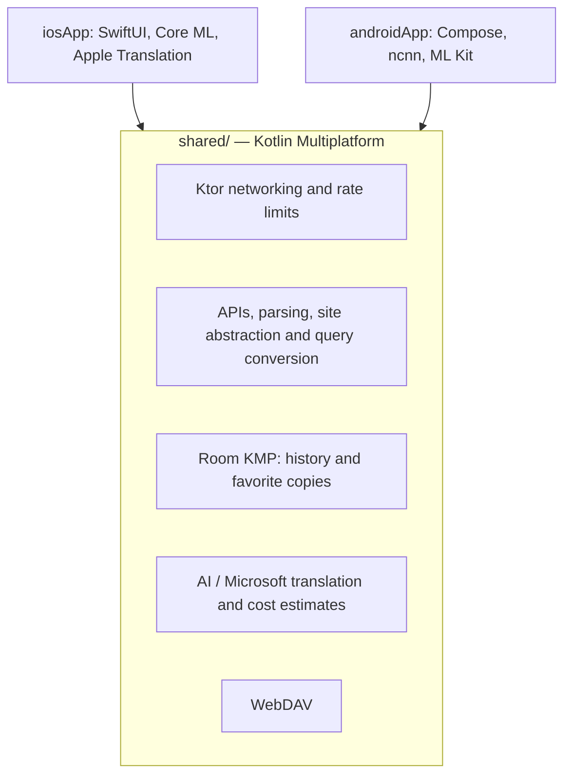

| Directory | Contents |
| --- | --- |
| `shared/` | Networking, site abstraction, parsing, database, sync, translation, rate limits, and tests |
| `androidApp/` | Kotlin/Compose app and Roborazzi screenshot tests |
| `iosApp/` | SwiftUI app; Xcode project generated by XcodeGen |
| `models/sr/` | Higher-quality ncnn and Core ML models |
| `tools/` | Localization (`i18n/`), icons (`icon/`), model conversion (`sr/`) |
| `design/` | Icon designs |
| `docs/` | Requirements, iOS signing instructions, README images |

Main dependencies: Kotlin 2.4, Ktor 3, Room KMP, Ksoup, kotlinx.serialization, Compose, Coil 3, and Nuke.

<a id="build"></a>
## Building from source

**Android:** JDK 21 and the Android SDK are required.

```bash
./gradlew :androidApp:assembleDebug
```

**iOS:** macOS, Xcode 26, XcodeGen, and JDK 21 are required. Xcode invokes Gradle to build the shared framework.

```bash
cd iosApp
xcodegen generate
open AENHT.xcodeproj
```

**Tests:**

```bash
./gradlew :shared:jvmTest :androidApp:testDebugUnitTest
```

Screenshot output is in `androidApp/build/screens/`. GitHub Actions builds APKs and IPAs on `main`/`dev` pushes; development builds update `dev-latest`. Publishing a Release builds its tag and attaches a signed APK and an unsigned IPA. See [iOS signing](docs/ios-signing.md).

## Roadmap

- [x] Browsing, searching, reading, and downloading from both sites
- [x] Combined favorites, history, and downloads
- [x] AI, Microsoft, and on-device title/comment translation; tag translation
- [x] First super-resolution implementation with Real-ESRGAN anime models
- [x] WebDAV and iCloud sync
- [x] Tablet layouts on iPad and Android tablets
- [x] Apple Pencil, Android stylus, Windows pen, keyboard and page-turner page turns
- ❌ **Comic-page translation (recognizing and translating text in images): not planned for now.** Translating an entire comic consumes too many tokens. On iPhone / iPad, use [AY-Translate](https://github.com/AtlanYuey/AY_Translate) to recognize and translate only the current page from a screenshot.
- [ ] Local favorites without login
- [ ] Data import from AEros-NHT
- [ ] Sort combined favorites by publication date

## License and acknowledgments

Apache License 2.0: see [LICENSE](LICENSE) and [NOTICE](NOTICE). Maintained by [AtlanYuey](https://github.com/AtlanYuey). This project is independent of the sites and projects listed below.

- [eros_n](https://github.com/honjow/eros_n), by honjow: AENHT's original starting point.
- [AEros-NHT](https://github.com/AtlanYuey/AEros-NHT): an earlier version of this application.
- [NextE](https://github.com/erosTeam/NextE) and [NextN](https://github.com/erosTeam/NextN), erosTeam, MIT: behavioral references for site features; their source code was not copied.
- [AY Translate](https://github.com/AtlanYuey/AY_Translate): AI service settings.
- [nhentai_tags_fetcher](https://github.com/honjow/nhentai_tags_fetcher), honjow: nhentai tag data.
- [EhTagTranslation](https://github.com/EhTagTranslation/Database), CC BY-NC-SA 3.0: Chinese tag translations.
- [LobeHub Icons](https://github.com/lobehub/lobe-icons), MIT: AI provider icons.
- [Real-ESRGAN](https://github.com/xinntao/Real-ESRGAN), BSD-3-Clause: super-resolution models.

**About › Open Source Licenses** lists the main third-party library, data, and model licenses. For adults aged 18 and over only.
