<p align="center">
  <a href="README.md">简体中文</a> · <a href="README.en.md">English</a> ·
  <b>Español</b> · <a href="README.ja.md">日本語</a> · <a href="README.ko.md">한국어</a>
</p>

<p align="center">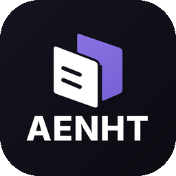</p>
<h1 align="center">AENHT</h1>
<p align="center">
  <b>All E-Hentai + nhentai HenTai</b><br>
  Cliente no oficial para explorar nhentai y E-Hentai / ExHentai en una sola aplicación<br>
  Interfaz nativa para iPhone / iPad con SwiftUI y para Android con Jetpack Compose; núcleo compartido con Kotlin Multiplatform
</p>
<p align="center">
  <a href="https://github.com/AtlanYuey/AENHT/releases/latest">Versión estable</a> ·
  <a href="https://github.com/AtlanYuey/AENHT/releases/tag/dev-latest">Última revisión</a> ·
  <a href="#features">Funciones</a> · <a href="#design">Diseño</a> ·
  <a href="#usage">Primeros pasos</a> · <a href="#build">Compilar</a>
</p>

> [!WARNING]
> Versión actual: 0.2.4. El proyecto está en desarrollo activo. Solo para personas de 18 años o más.
> Este proyecto no está afiliado a nhentai ni a E-Hentai.

<p align="center">
  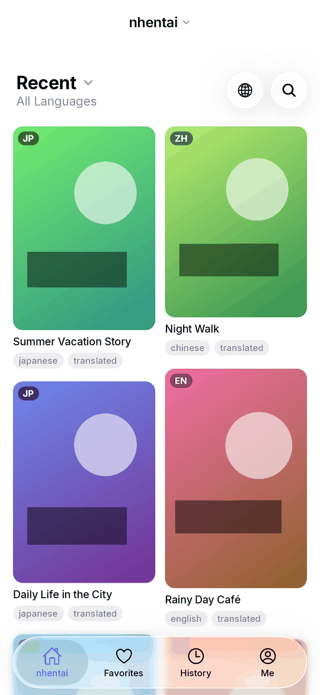
  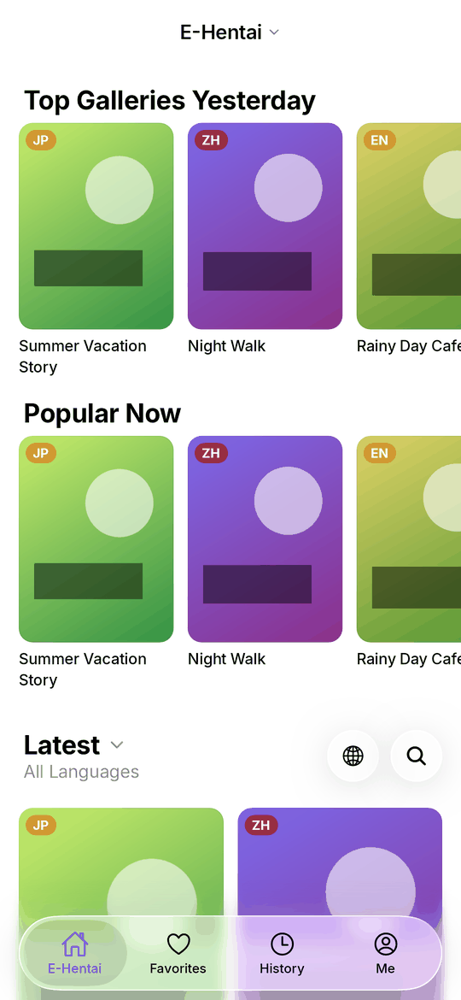
  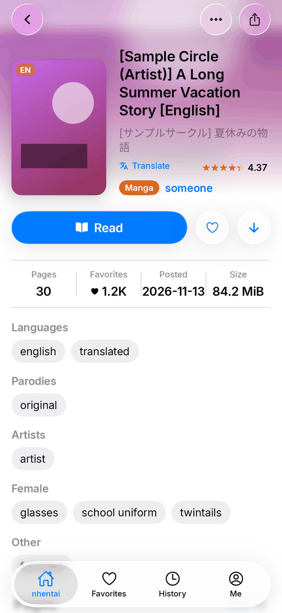
  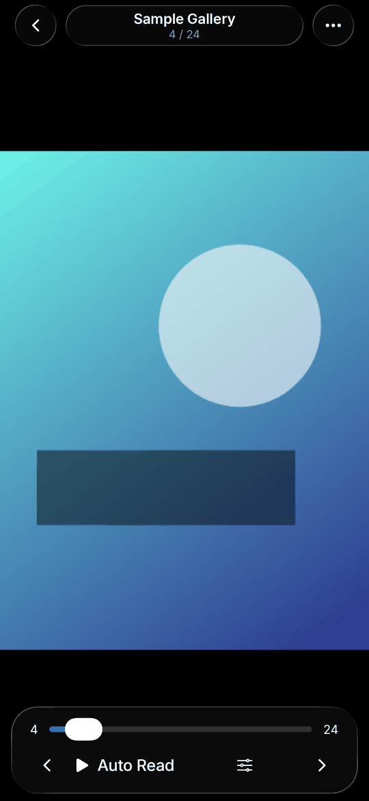
</p>
<p align="center"><sub>Capturas de las pruebas de interfaz de Android, con portadas y títulos de ejemplo. La versión de iOS sigue la misma estructura general.</sub></p>

## ¿Por qué AENHT?

Usar aplicaciones separadas para nhentai y E-Hentai obliga a mantener favoritos, historial y ajustes por duplicado. AENHT reúne ambos sitios:

- **Una interfaz para dos sitios:** inicio, búsqueda, detalles y lector mantienen una estructura común.
- **Favoritos, historial y descargas unificados:** cada elemento indica su sitio y se puede filtrar por origen.
- **Interfaz nativa:** SwiftUI en iOS, con Liquid Glass en iOS 26, y Compose en Android.
- **Núcleo compartido:** Kotlin Multiplatform reúne las conexiones, el análisis de páginas, la base de datos, la sincronización, la traducción y los límites de solicitudes.

<a id="features"></a>
## Funciones principales

| | nhentai | E-Hentai / ExHentai |
| --- | :---: | :---: |
| Inicio | Novedades; populares de hoy, semana, mes y siempre | Novedades, populares, seguidos y cuatro clasificaciones |
| Recomendaciones fijas, hasta dos filas | ✅ | ✅ |
| Búsqueda, sintaxis de etiquetas e historial | ✅ | ✅ Conversión al cambiar de sitio |
| Apertura directa | Número de galería | Enlace de galería |
| Información, etiquetas, miniaturas y comentarios | ✅ | ✅ También puntuaciones, torrents y archivos |
| Otros idiomas y ediciones | ✅ | ✅ |
| Galerías similares | ✅ | ✅ |
| Copia local de los favoritos de la cuenta | ✅ | ✅ Diez carpetas y notas |
| Comentarios | Publicar | Publicar, votar y bloquear autores |
| Cuentas | Inicio de sesión, clave API y varias cuentas | Inicio de sesión web, cookies, ExHentai y varias cuentas |
| Bloqueo en el sitio | Lista de etiquetas bloqueadas | Página My Tags |
| Descargas | ✅ | ✅ También imágenes originales y archivos oficiales |
| Votar o añadir etiquetas | — | ✅ |
| Cuota de imágenes y GP | — | ✅ |

Funciones comunes:

- **Lector:** varias direcciones, doble página, recorte automático, paso automático de páginas, desplazamiento continuo a velocidad ajustable, superresolución, zonas táctiles, gestos, pantalla encendida, brillo, escala de grises e inversión.
- **Traducción:** etiquetas al chino; títulos y comentarios mediante IA, Microsoft Translator o traducción en el dispositivo.
- **Filtros:** reglas compartidas de etiquetas, títulos y expresiones regulares.
- **Sincronización:** WebDAV entre iOS y Android; iCloud para los ajustes de iOS.
- **Privacidad:** bloqueo de la aplicación, protección al pasar a segundo plano y registros de diagnóstico.
- **Idiomas de interfaz:** 14.

## Capturas

<table>
  <tr>
    <td align="center"><br><sub>Inicio de nhentai</sub></td>
    <td align="center"><br><sub>E-Hentai y clasificaciones</sub></td>
    <td align="center">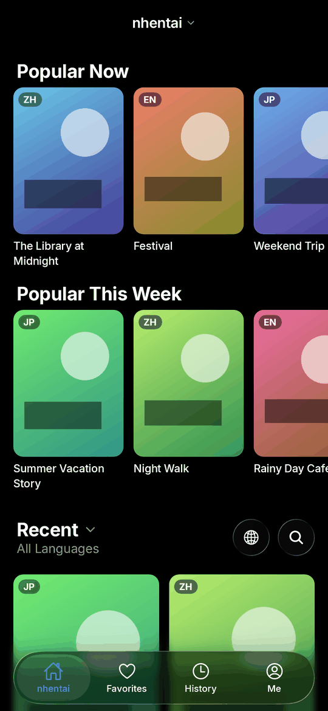<br><sub>Modo oscuro y recomendaciones</sub></td>
    <td align="center">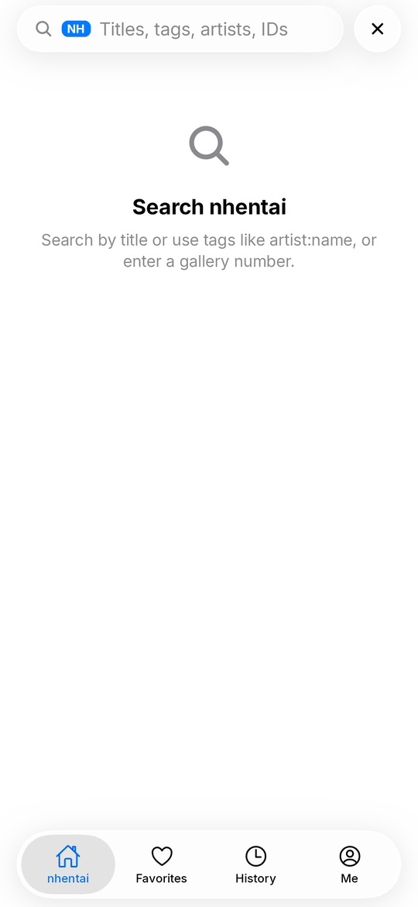<br><sub>Búsqueda</sub></td>
  </tr>
  <tr>
    <td align="center">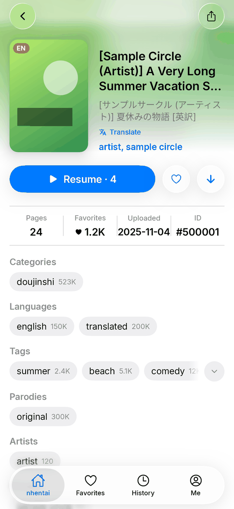<br><sub>Detalle de nhentai</sub></td>
    <td align="center"><br><sub>Detalle de E-Hentai</sub></td>
    <td align="center"><br><sub>Lector</sub></td>
    <td align="center">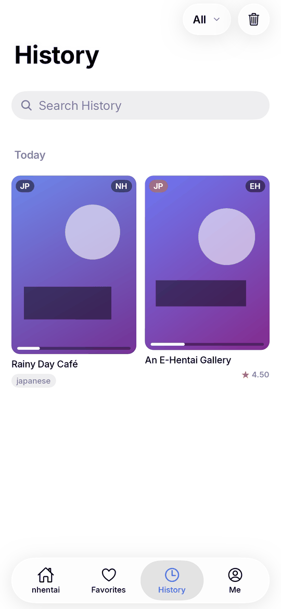<br><sub>Historial unificado</sub></td>
  </tr>
  <tr>
    <td align="center">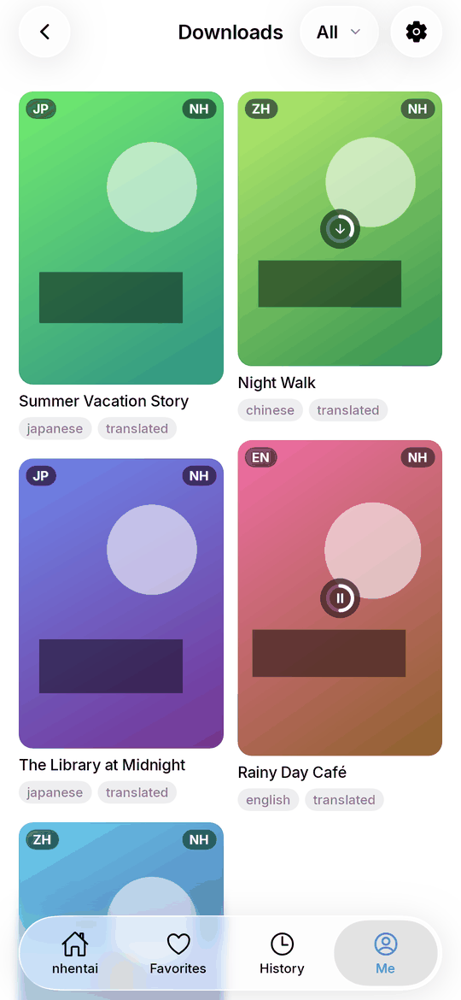<br><sub>Descargas</sub></td>
    <td align="center">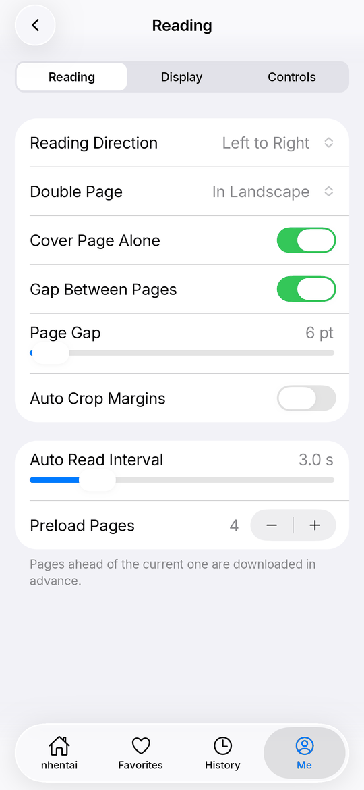<br><sub>Ajustes de lectura</sub></td>
    <td align="center">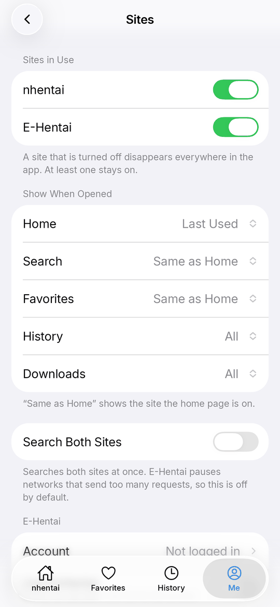<br><sub>Ajustes de sitios</sub></td>
    <td align="center">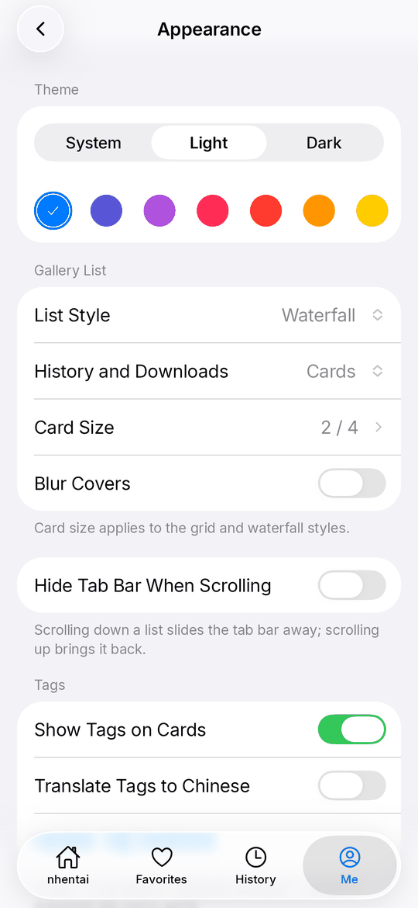<br><sub>Apariencia</sub></td>
  </tr>
  <tr>
    <td align="center">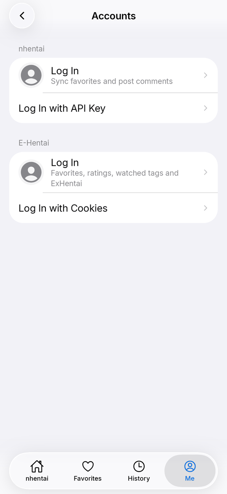<br><sub>Cuentas</sub></td>
    <td align="center">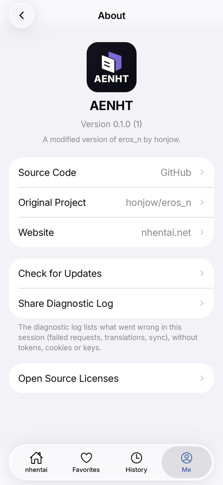<br><sub>Acerca de</sub></td>
    <td align="center" colspan="2">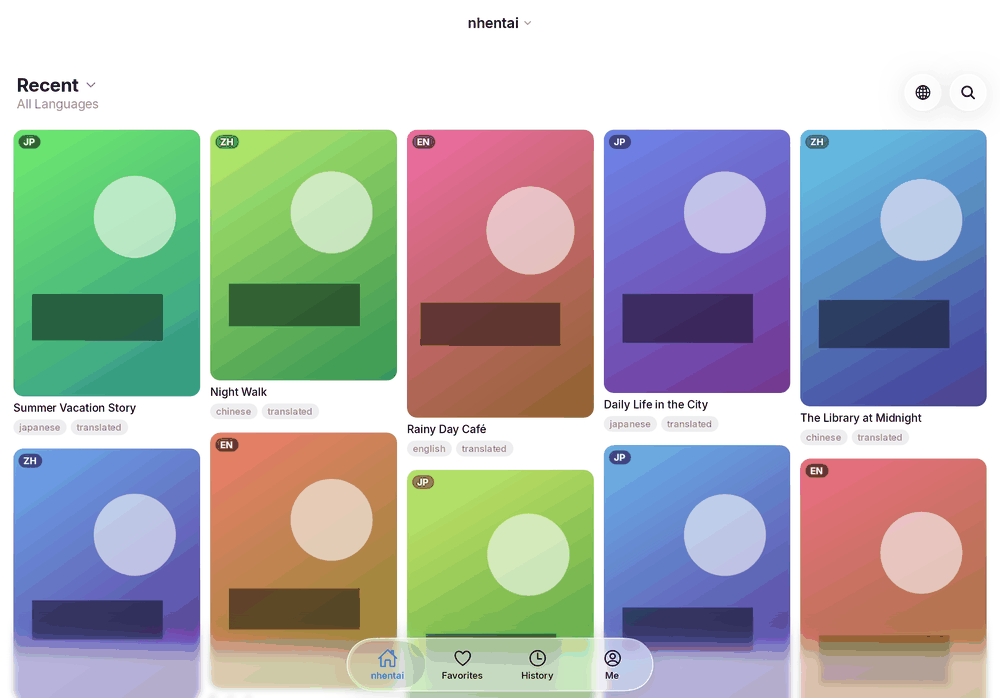<br><sub>Tableta en horizontal</sub></td>
  </tr>
</table>

<a id="design"></a>
## Diseño

### 1. Una aplicación, dos sitios y una interfaz

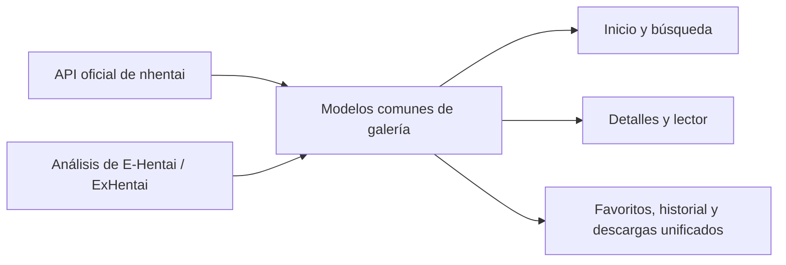

Los datos de ambos sitios se convierten a los mismos modelos. Las fichas siguen el orden información → etiquetas → páginas → otras ediciones → galerías similares → comentarios. Las funciones exclusivas, como puntuaciones, torrents y archivos de E-Hentai, conservan su lugar dentro de esa estructura.

- ExHentai es una opción de E-Hentai, no un tercer sitio independiente. El interruptor aparece junto a E-Hentai en **Perfil › Sitios** cuando E-Hentai está activado; las portadas llevan la marca EX.
- Cada página puede abrir la última selección, seguir el inicio o mostrar nhentai, E-Hentai o todos. Estos valores se configuran en los ajustes de sitios.
- La insignia superior izquierda indica el idioma; los colores corresponden a la categoría y se comparten entre sitios. Las listas unificadas muestran NH o EH arriba a la derecha.

### 2. Una cabecera compacta

- El nombre del sitio, centrado en un botón de cristal, permite cambiar de sitio. Sin un segundo sitio, se oculta la flecha.
- El dado superior derecho abre una galería aleatoria de nhentai.
- Debajo aparecen el orden actual y el idioma, con botones de idioma y búsqueda. Al desplazarse, estos controles pasan a la barra superior y regresan al volver al principio.
- Los botones son blancos en modo oscuro y negros en modo claro. La búsqueda se despliega en la misma página, con el selector de sitio debajo.
- El título de favoritos es un menú para elegir todos los sitios, uno concreto o una carpeta de E-Hentai.

### 3. Pulsaciones en la barra inferior

| Acción | Inicio / Favoritos / Historial | Perfil |
| --- | --- | --- |
| Una pulsación | Ir al principio | Volver un nivel |
| Otra pulsación | Volver a la posición anterior | Volver otro nivel |
| Doble pulsación rápida | Actualizar | — |

El encabezado **Páginas** de una galería alterna entre la primera página y la posición anterior. En iPad, la barra puede seguir el último lado tocado, con tres velocidades, o quedar fija a la izquierda, en el centro o a la derecha.

### 4. Lector y disposición en tabletas

- Al abrir una miniatura, se amplía hasta el lector. Al cerrarlo, vuelve a la miniatura de la **página actual**, que queda centrada en la fila.
- Los gestos se coordinan con las zonas táctiles: si las zonas están a izquierda/derecha, los gestos verticales pueden salir, mostrar controles o activar la lectura automática; con zonas arriba/abajo, esos gestos pasan al eje horizontal. Los deslizamientos en la dirección de lectura siguen pasando páginas.
- La pantalla se mantiene encendida cinco minutos desde el último toque por defecto y después vuelve al bloqueo automático del sistema, sin adelantarlo.
- La separación central de la doble página es de 6 pt por defecto. El ajuste de separación entre páginas solo corresponde al modo continuo con espacios.
- En horizontal, la tableta muestra información y páginas lado a lado, dos columnas de recomendaciones y una sección Perfil con dos paneles. El resumen incluye cuentas, descargas, historial, favoritos, sincronización y versión. Las portadas cortadas conservan las esquinas redondeadas; iOS 26 añade desenfoques graduales suaves.
- Al girar, las listas conservan la tarjeta visible. En iOS se utiliza UICollectionView para las listas de galerías.

### 5. Superresolución cuando hace falta

Los modelos de anime Real-ESRGAN se ejecutan localmente con Core ML en iOS y ncnn en Android. Primero se muestra la imagen original y se sustituye al terminar. El modo automático procesa imágenes claramente menores que su área de visualización. Con la superresolución activada, la página visible tiene prioridad y las siguientes imágenes que cumplan los requisitos pueden procesarse por adelantado. Hay un modelo incluido y modelos de mayor calidad descargables desde los ajustes.

### 6. Traducción con alternativas

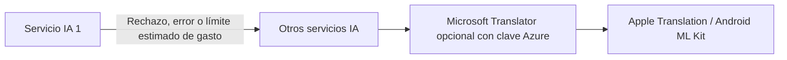

La configuración sigue [AY Translate](https://github.com/AtlanYuey/AY_Translate): DeepSeek, Gemini, OpenAI, Qwen, SiliconFlow, Kimi, Zhipu, OpenRouter y servicios compatibles con OpenAI. Al pegar una clave se carga la lista de modelos. Se puede probar una frase, usar parámetros predefinidos o JSON personalizado y definir precios y un límite mensual estimado. Las claves permanecen en el llavero o almacenamiento cifrado local. Un aviso indica el servicio al que se ha cambiado.

Los títulos traducidos sustituyen al original y un toque permite alternarlos. Las etiquetas usan la base de traducción al chino de EhTagTranslation, con actualización semanal, también en las tarjetas del inicio.

### 7. Respetar los límites de los sitios

Cada sitio tiene un limitador global según las restricciones de nhentai y E-Hentai. Las esperas largas muestran una cuenta atrás. No se ofrece desactivar el límite, para reducir el riesgo de bloqueos de IP en E-Hentai. La búsqueda simultánea en ambos sitios está desactivada por defecto. Se pueden ajustar concurrencia, reintentos y espera entre páginas; E-Hentai permite como máximo tres páginas descargándose a la vez.

### 8. Niveles de privacidad

En el selector de aplicaciones se pueden desenfocar solo imágenes, imágenes y texto, toda la aplicación, o cubrirla con un color. Por defecto solo se desenfocan imágenes; desenfocar imágenes y texto mantiene legibles los controles de ajustes. El bloqueo admite Face ID, Touch ID, huella y credenciales del dispositivo. Las portadas pueden permanecer desenfocadas durante el uso.

## Funciones detalladas

<details>
<summary><b>Inicio y búsqueda</b></summary>

- nhentai: novedades y populares de hoy, semana, mes o siempre. E-Hentai: novedades, populares, seguidos y clasificaciones de ayer, mes, año o siempre.
- Hasta dos filas fijas se cargan y aparecen juntas. Por defecto: populares actuales + semanales en nhentai; clasificación de ayer + populares actuales en E-Hentai.
- Cascada, cascada compacta, cuadrícula y lista; tamaño de tarjetas distinto en vertical y horizontal; columnas adaptadas a pantalla dividida y Stage Manager.
- Etiquetas traducibles en las tarjetas, filtro de idioma y dado aleatorio de nhentai.
- La búsqueda usa el sitio actual salvo que se active buscar en ambos. Cambiar de sitio convierte la sintaxis compatible y señala las condiciones no aplicables.
- Un número ofrece la galería de nhentai correspondiente sobre los resultados; un enlace de E-Hentai / ExHentai ofrece esa galería. Al regresar a la app puede preguntarse si se quiere abrir un enlace del portapapeles.
- Autocompletado local de etiquetas e historial común con indicación de sitio. Se puede desactivar el guardado del historial.
</details>

<details>
<summary><b>Detalles de galería</b></summary>

- Portada, títulos original y traducido, autores, categoría y puntuación de E-Hentai. Leer, continuar desde una página, añadir a favoritos y descargar.
- Información de páginas, favoritos, fecha de publicación, tamaño o número de galería.
- Etiquetas agrupadas por espacio de nombres: tocar para buscar, mantener pulsado para copiar; en E-Hentai también se pueden votar y añadir.
- Miniaturas, encabezado Páginas que alterna primera página/posición anterior y botón Todas a la derecha.
- Otras traducciones y ediciones; recomendaciones oficiales de nhentai o búsquedas sucesivas por autor/grupo, obra + personaje y temas en E-Hentai.
- Comentarios en ambos sitios; en E-Hentai se pueden votar, copiar y bloquear autores. Admiten traducción y filtros.
- E-Hentai añade carpetas y notas de favoritos, torrents, descarga oficial de archivos con GP y apertura en el navegador.
</details>

<details>
<summary><b>Lector</b></summary>

- Lectura de izquierda a derecha, de derecha a izquierda, de arriba abajo, continua Webtoon y continua con separación ajustable.
- Doble página en horizontal o siempre, portada independiente, avance de una página por pliego y separación central opcional: 6 pt por defecto, ajustable entre 2–60 pt.
- Recorte automático de bordes blancos, intervalo de paso automático y precarga de páginas siguientes.
- Desplazamiento continuo a velocidad ajustable. A 3 segundos por pantalla o menos, se muestra una advertencia roja. El interruptor para continuar tras deslizar está debajo de la velocidad y desactivado por defecto.
- El lector decodifica de antemano las dos imágenes que siguen bajo la pantalla en el modo continuo, o las dos siguientes vistas en el modo paginado (hasta cuatro imágenes con doble página). Esta función está siempre activa. El ajuste de precarga controla por separado cuántas páginas se descargan de antemano.
- Animaciones opcionales, fundido al desactivarlas y paso por deslizamiento con fundido direccional sin arrastrar la página con el dedo.
- Zonas táctiles laterales o superiores/inferiores; gestos largos perpendiculares para salir, mostrar controles o activar la lectura automática; pellizco y doble toque para ampliar.
- Pantalla encendida: desactivado, 5 minutos, 10 minutos o siempre. Superresolución: desactivada, automática o siempre, con modelos adicionales.
- Brillo, escala de grises e inversión solo en las páginas; salto, guardado y uso compartido de páginas; botones de volumen para pasar página en Android.
- Controles ocultos tras inactividad. Ajustes separados en Lectura, Pantalla y Controles.
</details>

<details>
<summary><b>Favoritos, historial y descargas</b></summary>

- Copias locales de favoritos de ambas cuentas, unificadas por fecha y disponibles sin conexión. nhentai no facilita fechas: se conserva el orden inicial y se fecha cada favorito descubierto después.
- Filtro por sitio y por las diez carpetas de E-Hentai, selección de carpetas visibles en Todos y búsqueda de favoritos. Si una acción de añadir/quitar falla, se revierte.
- Historial conjunto por días, con filtros de sitio, búsqueda y progreso de lectura.
- Descargas agrupadas por estado, selección múltiple, pausa, continuación, eliminación y exportación CBZ para compartir o guardar en archivos/descargas.
- Ajustes de galerías y páginas simultáneas, reintentos, espera entre páginas e imágenes originales; historial y descargas en tarjetas o lista.
</details>

<details>
<summary><b>Cuentas y filtros</b></summary>

- Varias cuentas por sitio y cambio mediante un toque; E-Hentai utiliza un avatar con las letras EH.
- nhentai admite credenciales o clave API y su lista de etiquetas bloqueadas.
- E-Hentai admite inicio web o cookies, incluido `igneous` para ExHentai, comprobación de acceso, cuota de imágenes, coste en GP y enlaces a ajustes del sitio y My Tags.
- Filtros comunes de etiquetas, títulos y expresiones regulares. Las etiquetas ignoran el espacio de nombres y pueden coincidir con `tag:` de nhentai o `female:` / `male:` de E-Hentai.
- Las galerías filtradas se ocultan del inicio y la búsqueda. La lista de nhentai añade otra capa. Los autores de comentarios bloqueados se ocultan en todas las galerías.
</details>

<details>
<summary><b>Sincronización, copias de seguridad y otros ajustes</b></summary>

- WebDAV sincroniza ajustes, historial y copias de favoritos entre Android y iPhone. Compatible con Nextcloud, NAS y Jianguoyun con contraseña de aplicación; sincronización opcional al abrir o pasar a segundo plano.
- Con ETag, se detectan cambios simultáneos antes de subir, se combinan y se reintenta. Si el conflicto persiste, se pide reintentar más tarde, sin sobrescribir. Los servidores sin ETag carecen de esta protección: evita sincronizar dos dispositivos a la vez.
- Los favoritos sincronizados se ocultan hasta completar una lectura de los favoritos del sitio con la cuenta actual, evitando mostrar los de otra cuenta.
- iCloud sincroniza ajustes con la cuenta Apple: entre iPhone/iPad o solo entre dispositivos del mismo tipo. La sincronización del número de columnas es opcional.
- Exportación/importación de ajustes en archivo. La copia del sistema Android solo incluye ajustes; historial y favoritos dependen de WebDAV. Los archivos descargados son locales.
- Comprobación de versión estable y de desarrollo. El diagnóstico registra fallos de solicitudes, traducción y sincronización de la sesión y elimina formatos reconocidos de tokens, cookies, claves y contraseñas. Revisa el contenido antes de compartirlo.
- Apariencia del sistema, clara u oscura; colores de acento y barras que se ocultan al desplazarse, con opción de reducir la inferior a un botón.
- Idiomas de la app: chino simplificado y tradicional, inglés, japonés, coreano, español, francés, alemán, italiano, portugués de Brasil, ruso, vietnamita, tailandés e indonesio.
</details>

<a id="usage"></a>
## Primeros pasos

### Instalación

Las versiones estables están en [Releases](https://github.com/AtlanYuey/AENHT/releases/latest) y las actualizaciones de desarrollo en [dev-latest](https://github.com/AtlanYuey/AENHT/releases/tag/dev-latest). **Acerca de › Buscar actualizaciones** ofrece ambos enlaces.

| Plataforma | Archivo | Requisitos |
| --- | --- | --- |
| Android | `.apk` | Android 10 o posterior |
| iPhone / iPad | `.ipa` | iOS / iPadOS 18 o posterior; recomendado 26 |

Instala el APK directamente. Las versiones publicadas conservan el certificado para actualizar sobre la instalación existente; las pruebas anteriores a 0.1.0 requieren desinstalar una vez. El IPA público no está firmado: usa tu Apple ID con AltStore, SideStore, Sideloadly u otra herramienta similar.

### Primera apertura

1. Se abre el inicio de nhentai; toca el nombre superior para cambiar a E-Hentai.
2. Elige sitios y pantallas iniciales en **Perfil › Sitios**.
3. No hace falta cuenta para explorar, buscar, leer o descargar. Los favoritos de la cuenta, comentarios y ExHentai requieren sesión.
   - nhentai: **Perfil › Cuentas › nhentai › Iniciar sesión** o crea una clave en nhentai.net › Settings › API Keys y usa el acceso con clave API.
   - E-Hentai: **Perfil › Cuentas › E-Hentai › Iniciar sesión**. Si falla el acceso web, copia `ipb_member_id`, `ipb_pass_hash` y, para ExHentai, `igneous` de un navegador con sesión, y elige acceso con cookies.
   - Activa ExHentai desde la cuenta E-Hentai o los ajustes de sitios cuando tu cuenta tenga permiso.

### Configurar traducción y sincronización

- Etiquetas al chino: **Apariencia › Traducir etiquetas al chino**.
- Títulos/comentarios: **Perfil › Traducción › Añadir servicio de IA**. Elige proveedor, pega la clave, espera los modelos, prueba y ordena los servicios arrastrándolos.
- Sin clave se utiliza traducción local. La primera vez se descargan idiomas: iOS lo solicita mediante el sistema y Android usa unos 30 MB por idioma.
- WebDAV: **Perfil › Sincronización WebDAV**; introduce dirección y credenciales y conecta. Los datos se guardan en la carpeta `AENHT` del servidor.
- iCloud: **Perfil › Sincronización con iCloud**. La firma necesita la capacidad iCloud; muchas firmas de instalación alternativa no la incluyen. Se puede usar exportación/importación de ajustes.

### Gestos

| Lugar | Acción | Resultado |
| --- | --- | --- |
| Barra inferior | Tocar / repetir / doble toque rápido | Inicio / posición anterior / actualizar |
| Encabezado Páginas | Tocar / repetir | Primera página / posición anterior |
| Título traducido | Tocar | Alternar traducción y original |
| Etiqueta | Tocar / mantener pulsado | Buscar / copiar |
| Comentario de E-Hentai | Mantener pulsado | Votar, copiar, bloquear |
| Lector | Zonas táctiles / centro | Pasar página / mostrar controles |
| Lector | Deslizamiento largo perpendicular | Salir, controles o lectura automática, según ajuste |
| Lector | Pellizco / doble toque | Ampliar |

## Estructura del proyecto

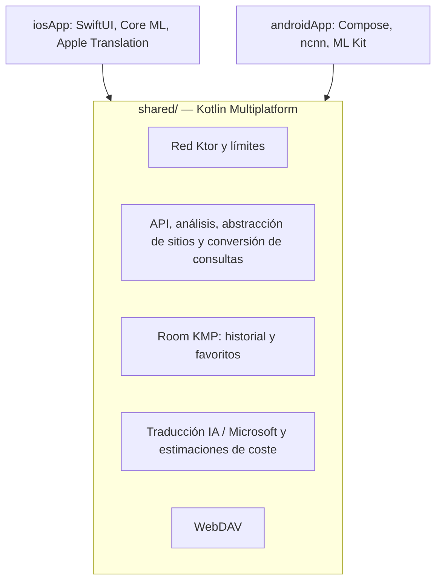

| Directorio | Contenido |
| --- | --- |
| `shared/` | Red, sitios, análisis, base de datos, sincronización, traducción, límites y pruebas |
| `androidApp/` | App Kotlin/Compose y pruebas visuales Roborazzi |
| `iosApp/` | App SwiftUI; proyecto Xcode generado por XcodeGen |
| `models/sr/` | Modelos ncnn y Core ML de mayor calidad |
| `tools/` | Textos (`i18n/`), iconos (`icon/`), conversión de modelos (`sr/`) |
| `design/` | Diseño de iconos |
| `docs/` | Requisitos, firma iOS e imágenes del README |

Dependencias principales: Kotlin 2.4, Ktor 3, Room KMP, Ksoup, kotlinx.serialization, Compose, Coil 3 y Nuke.

<a id="build"></a>
## Compilar desde el código fuente

**Android:** se necesitan JDK 21 y Android SDK.

```bash
./gradlew :androidApp:assembleDebug
```

**iOS:** se necesitan macOS, Xcode 26, XcodeGen y JDK 21. Xcode ejecuta Gradle para compilar el framework compartido.

```bash
cd iosApp
xcodegen generate
open AENHT.xcodeproj
```

**Pruebas:**

```bash
./gradlew :shared:jvmTest :androidApp:testDebugUnitTest
```

Las capturas se generan en `androidApp/build/screens/`. GitHub Actions compila APK e IPA al enviar a `main` o `dev`; `dev` actualiza `dev-latest`. Publicar un Release compila su etiqueta y adjunta un APK firmado y un IPA sin firmar. Consulta [la firma de iOS](docs/ios-signing.md).

## Hoja de ruta

- [x] Explorar, buscar, leer y descargar en ambos sitios
- [x] Favoritos, historial y descargas unificados
- [x] Traducción de títulos y comentarios con IA, Microsoft o local; etiquetas traducidas
- [x] Primera implementación de superresolución con modelos de anime Real-ESRGAN
- [x] Sincronización WebDAV e iCloud
- ❌ **Traducción de páginas de cómic (reconocer y traducir texto de las imágenes): no se contempla por ahora.** Traducir un cómic entero consume demasiados tokens. En iPhone / iPad se puede usar [AY-Translate](https://github.com/AtlanYuey/AY_Translate) para reconocer y traducir solo la página actual mediante una captura de pantalla.
- [ ] Favoritos locales sin iniciar sesión
- [ ] Importar datos de AEros-NHT
- [ ] Ordenar todos los favoritos por fecha de publicación

## Licencia y agradecimientos

Apache License 2.0: consulta [LICENSE](LICENSE) y [NOTICE](NOTICE). Mantenimiento de [AtlanYuey](https://github.com/AtlanYuey). El proyecto es independiente de los sitios y de los proyectos siguientes.

- [eros_n](https://github.com/honjow/eros_n), honjow: punto de partida original de AENHT.
- [AEros-NHT](https://github.com/AtlanYuey/AEros-NHT): versión anterior de esta aplicación.
- [NextE](https://github.com/erosTeam/NextE) y [NextN](https://github.com/erosTeam/NextN), erosTeam, MIT: referencias de comportamiento; no se ha copiado su código fuente.
- [AY Translate](https://github.com/AtlanYuey/AY_Translate): ajustes de servicios de IA.
- [nhentai_tags_fetcher](https://github.com/honjow/nhentai_tags_fetcher), honjow: datos de etiquetas de nhentai.
- [EhTagTranslation](https://github.com/EhTagTranslation/Database), CC BY-NC-SA 3.0: traducciones de etiquetas al chino.
- [LobeHub Icons](https://github.com/lobehub/lobe-icons), MIT: iconos de proveedores de IA.
- [Real-ESRGAN](https://github.com/xinntao/Real-ESRGAN), BSD-3-Clause: modelos de superresolución.

**Acerca de › Licencias de código abierto** muestra las licencias principales de bibliotecas, datos y modelos. Solo para personas de 18 años o más.
