<p align="center">
  <a href="README.md">简体中文</a> · <a href="README.en.md">English</a> ·
  <a href="README.es.md">Español</a> · <b>日本語</b> · <a href="README.ko.md">한국어</a>
</p>

<p align="center">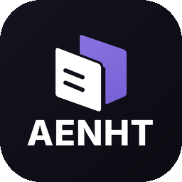</p>
<h1 align="center">AENHT</h1>
<p align="center">
  <b>All E-Hentai + nhentai HenTai</b><br>
  nhentai と E-Hentai / ExHentai を一つのアプリで閲覧できる非公式クライアント<br>
  iPhone / iPad は SwiftUI、Android は Jetpack Compose のネイティブ UI。共通処理には Kotlin Multiplatform を使用
</p>
<p align="center">
  <a href="https://github.com/AtlanYuey/AENHT/releases/latest">正式版</a> ·
  <a href="https://github.com/AtlanYuey/AENHT/releases/tag/dev-latest">最新の更新</a> ·
  <a href="#features">機能</a> · <a href="#design">設計</a> ·
  <a href="#usage">使い方</a> · <a href="#build">ビルド</a>
</p>

> [!WARNING]
> 現在のバージョンは 0.2.3 です。開発を継続しています。18 歳以上の方のみ利用できます。
> 本プロジェクトは nhentai、E-Hentai とは関係ありません。

<p align="center">
  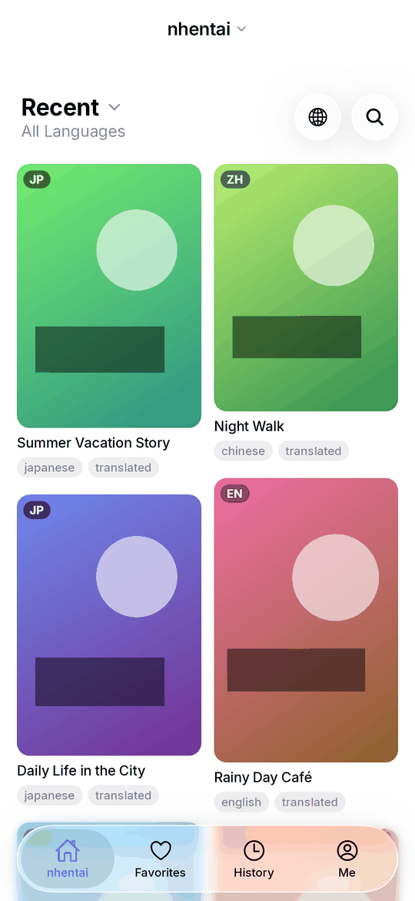
  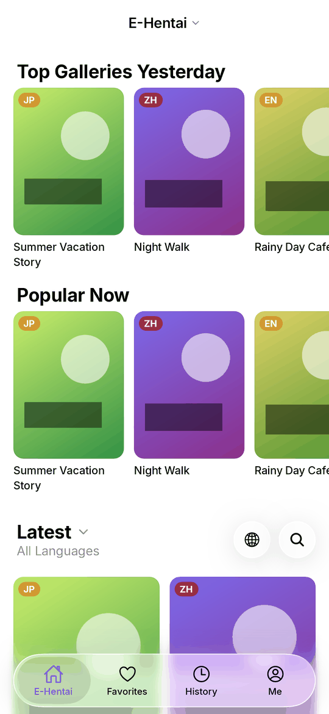
  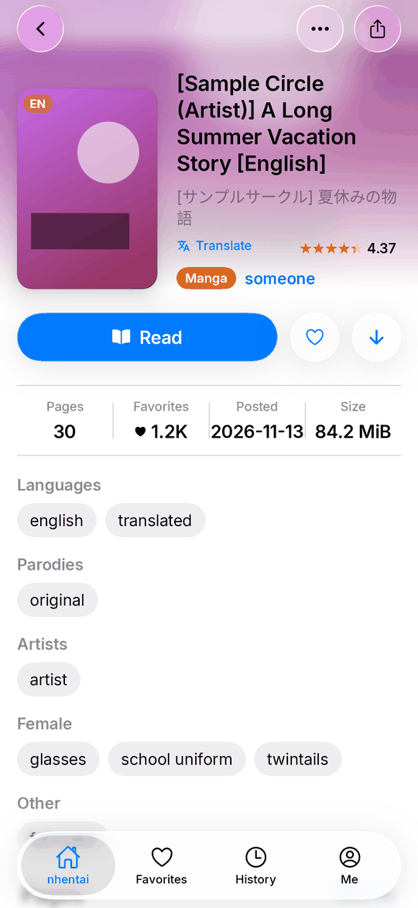
  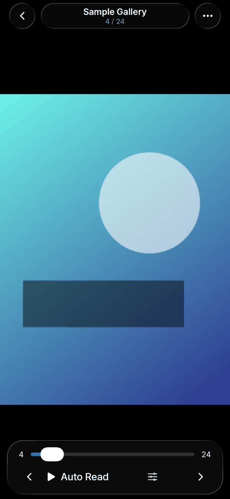
</p>
<p align="center"><sub>画像は Android の UI テストによるもので、表紙とタイトルはサンプルです。iOS 版も同じ基本構成を採用しています。</sub></p>

## AENHT を作った理由

nhentai と E-Hentai に別々のアプリを使うと、お気に入り、履歴、設定も別々になります。AENHT はそれらを一つにまとめます。

- **二つのサイトを同じ操作で：** ホーム、検索、作品詳細、リーダーの構成を統一しています。
- **お気に入り・履歴・ダウンロードを統合：** サイトの印を付けてまとめて表示し、サイト別にも絞り込めます。
- **ネイティブ UI：** iOS は SwiftUI と iOS 26 の Liquid Glass、Android は Compose を使用します。
- **共通の処理：** 通信、解析、データベース、同期、翻訳、レート制限を Kotlin Multiplatform で共有します。

<a id="features"></a>
## 機能一覧

| | nhentai | E-Hentai / ExHentai |
| --- | :---: | :---: |
| ホーム | 新着、今日・週間・月間・全期間の人気作品 | 新着、人気、ウォッチ、4 種類のランキング |
| 最大 2 行の固定おすすめ | ✅ | ✅ |
| 検索・タグ構文・検索履歴 | ✅ | ✅ サイト切り替え時に構文を変換 |
| 番号・リンクから直接開く | 作品番号 | 作品リンク |
| 詳細情報・タグ・ページ一覧・コメント | ✅ | ✅ 評価・Torrent・アーカイブも利用可能 |
| 別言語・別バージョン | ✅ | ✅ |
| 類似作品 | ✅ | ✅ |
| アカウントのお気に入りをローカル同期 | ✅ | ✅ 10 個のフォルダーとメモ |
| コメント | 投稿 | 投稿・投票・投稿者のブロック |
| アカウント | ログイン・API キー・複数アカウント | Web ログイン・Cookie・ExHentai・複数アカウント |
| サイト側のブロック | アカウントのタグブラックリスト | My Tags の Web ページ |
| ダウンロード | ✅ | ✅ 原寸画像・公式アーカイブも対応 |
| タグへの投票・追加 | — | ✅ |
| 画像割り当てと GP | — | ✅ |

両サイトで共通して使える機能：

- **リーダー：** 読み方向、見開き、自動余白除去、自動ページ送り、速度調整付き連続自動スクロール、超解像、タップ領域、ジェスチャー、画面点灯維持、明るさ・グレースケール・反転。
- **翻訳：** タグの中国語訳。タイトルとコメントは AI、Microsoft Translator、端末内翻訳に対応。
- **フィルター：** タグ、タイトル、正規表現の共通ルール。
- **同期：** iOS / Android 間の WebDAV、iOS 設定の iCloud 同期。
- **プライバシー：** アプリロック、バックグラウンド時の表示保護、診断ログ。
- **表示言語：** 14 言語。

## スクリーンショット

<table>
  <tr>
    <td align="center"><br><sub>nhentai ホーム</sub></td>
    <td align="center"><br><sub>E-Hentai とランキング</sub></td>
    <td align="center">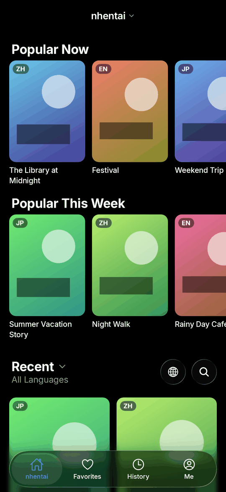<br><sub>ダークモード・おすすめ</sub></td>
    <td align="center">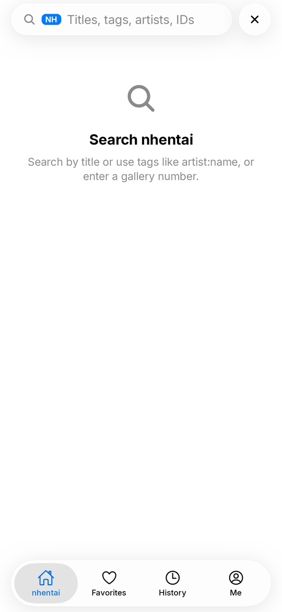<br><sub>検索</sub></td>
  </tr>
  <tr>
    <td align="center">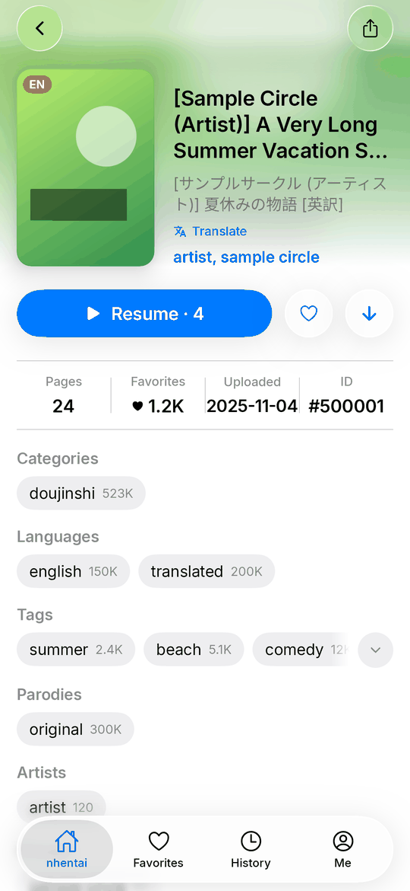<br><sub>nhentai 作品詳細</sub></td>
    <td align="center"><br><sub>E-Hentai 作品詳細</sub></td>
    <td align="center"><br><sub>リーダー</sub></td>
    <td align="center">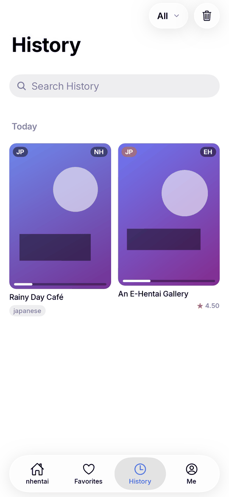<br><sub>統合履歴</sub></td>
  </tr>
  <tr>
    <td align="center">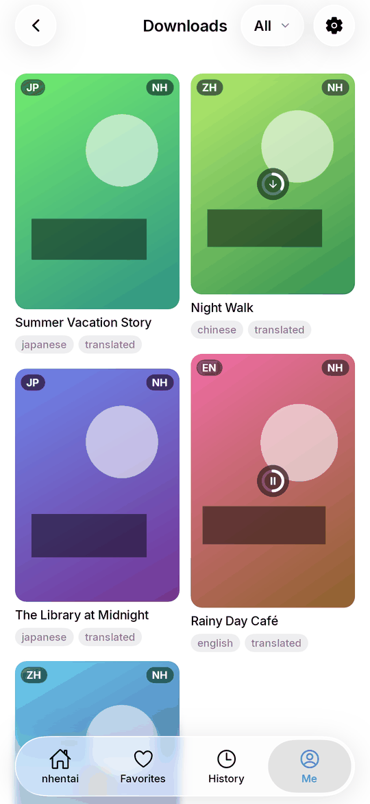<br><sub>ダウンロード</sub></td>
    <td align="center">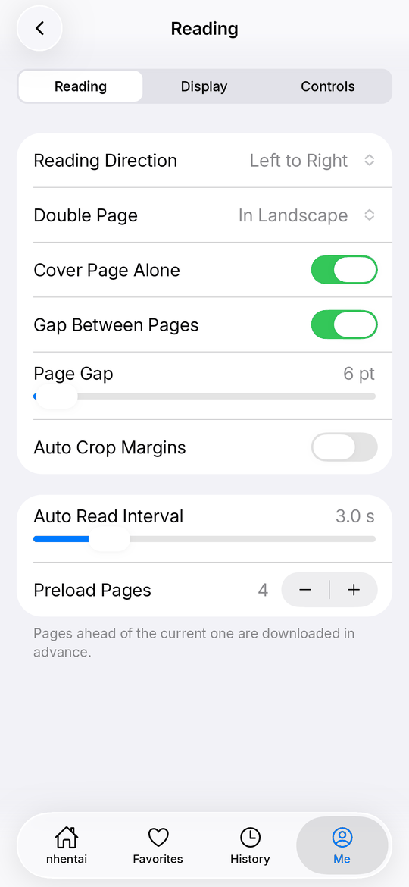<br><sub>閲覧設定</sub></td>
    <td align="center">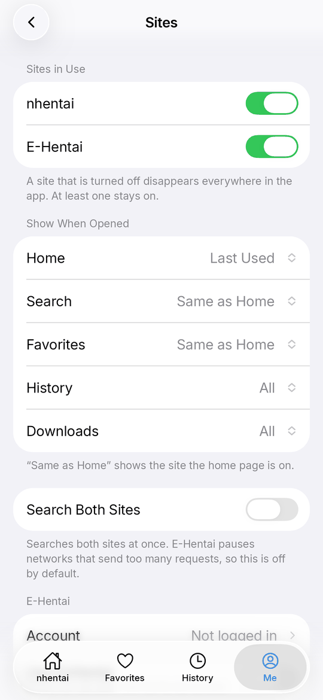<br><sub>サイト設定</sub></td>
    <td align="center">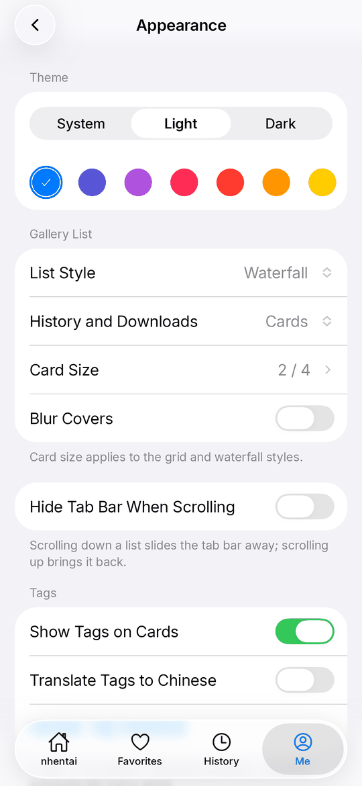<br><sub>外観</sub></td>
  </tr>
  <tr>
    <td align="center">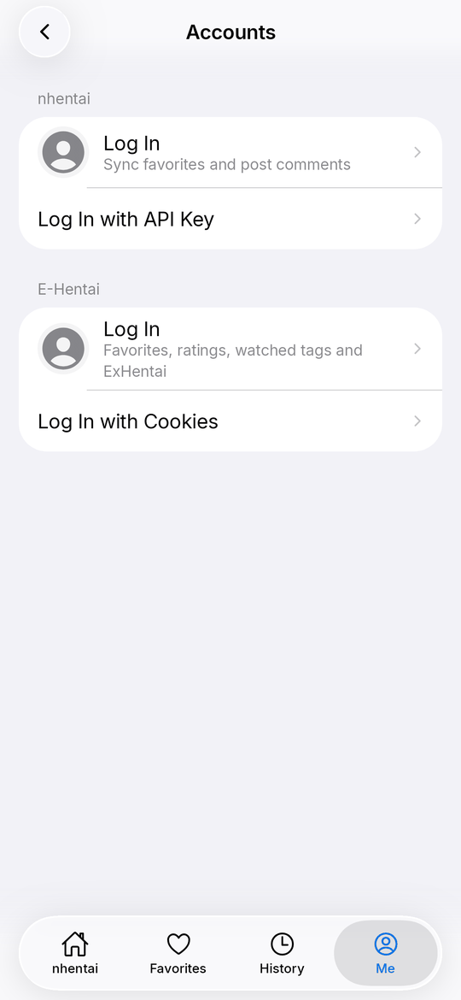<br><sub>アカウント</sub></td>
    <td align="center">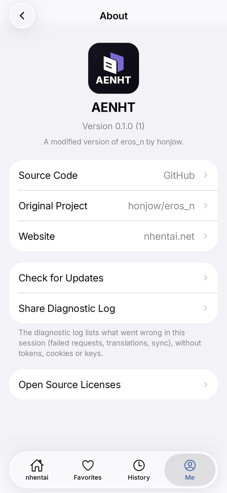<br><sub>アプリ情報</sub></td>
    <td align="center" colspan="2">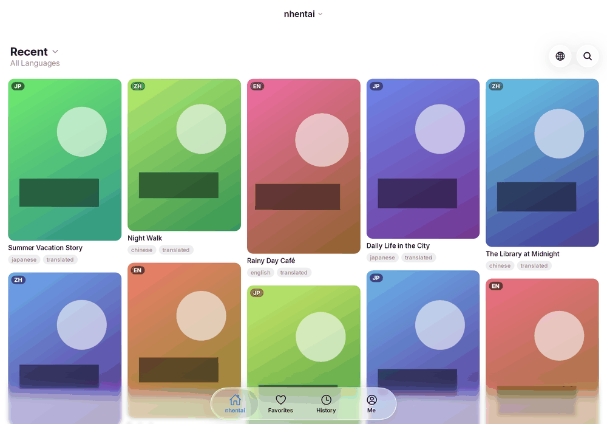<br><sub>タブレットの横画面</sub></td>
  </tr>
</table>

<a id="design"></a>
## 設計方針

### 1. 二つのサイトに共通の画面

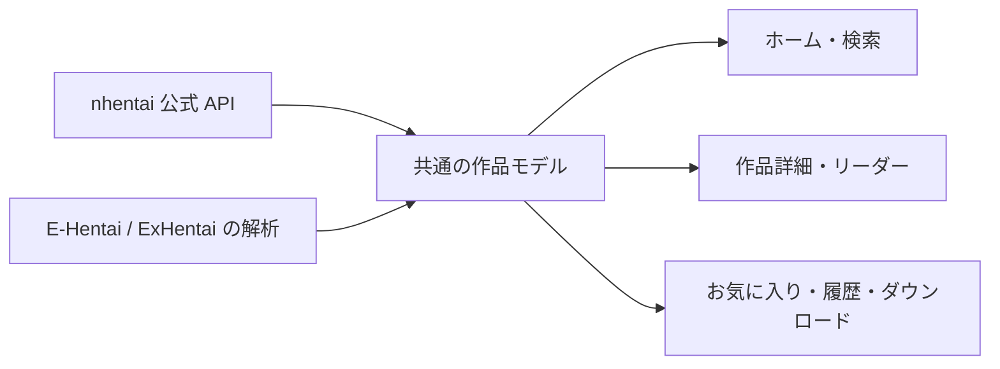

サイトごとのデータを共通モデルに変換します。作品詳細は、情報 → タグ → ページ → 別バージョン → 類似作品 → コメントの順で統一し、評価や Torrent、アーカイブなどの固有機能を適切な位置に置きます。

- ExHentai は独立した三つ目のサイトではなく、E-Hentai のオプションです。**マイページ › サイト**で E-Hentai を有効にすると隣に切り替えが表示され、表紙には EX の印が付きます。
- 各ページの初期表示は、前回の選択、ホームに追従、nhentai、E-Hentai、すべてから選べます。サイト設定にまとめています。
- 左上の印は言語を示し、色は作品の分類に合わせて両サイトで共通にします。統合一覧では右上に NH / EH を表示します。

### 2. コンパクトな上部バー

- 中央のガラスボタンにあるサイト名を押すとサイトを切り替えます。一つしか有効でない場合は矢印を隠します。
- nhentai のランダム作品は右上のサイコロです。
- その下に並び順と言語、言語・検索ボタンを表示します。下へスクロールすると上部バーに移り、先頭に戻ると元に戻ります。
- ボタンはダークモードで白、ライトモードで黒。検索は同じ画面内で展開し、その下にサイト切り替えを置きます。
- お気に入りのタイトル自体がメニューで、すべて・サイト別・E-Hentai のフォルダーを切り替えます。

### 3. 下部バーのタップ操作

| 操作 | ホーム / お気に入り / 履歴 | マイページ |
| --- | --- | --- |
| 1 回タップ | 先頭へ | 1 階層戻る |
| もう一度タップ | 直前の位置へ | さらに戻る |
| 素早く 2 回タップ | 更新 | — |

作品詳細の**ページ**見出しも、先頭と直前の位置を往復します。iPad の下部バーは最後に触れた側へ移動でき、移動速度は 3 段階。左・中央・右への固定も可能です。

### 4. リーダーの遷移とタブレット表示

- サムネイルから画像が広がるように開き、閉じると**現在のページ**のサムネイルへ戻ります。ページ一覧もその位置を中央に表示します。
- タップ領域が左右の場合は上下スワイプに終了・操作表示・自動送りを割り当てられ、領域が上下の場合は左右スワイプを使います。読み方向へのスワイプはページ送りに使い、競合させません。
- 画面点灯維持は最後のタッチから既定で 5 分。その後はシステムの自動ロックに戻り、システムより早く消灯させません。
- 見開き中央の間隔は既定で 6 pt。「ページ間隔」は隙間付き連続読みでのみ調整します。
- タブレットの横画面では作品情報とページ一覧を左右に表示し、おすすめは 2 列、マイページは一覧と詳細の 2 ペインになります。概要にはアカウント、ダウンロード、履歴・お気に入り数、同期状態、バージョンを表示します。境界にかかる表紙も角丸を維持し、iOS 26 では柔らかいグラデーションぼかしを使います。
- 回転時も閲覧中のカード位置を維持します。iOS の作品一覧は UICollectionView を使用します。

### 5. 必要なときに超解像

Real-ESRGAN のアニメ向けモデルを、iOS は Core ML、Android は ncnn で端末上で実行します。元画像を先に表示し、処理後に差し替えます。自動モードは表示領域より明らかに小さい画像を対象とします。超解像を有効にすると、表示中のページを優先しながら、対象となる後続の画像も先に処理します。標準モデルは同梱し、高品質モデルは設定から追加ダウンロードできます。

### 6. 翻訳のフォールバック

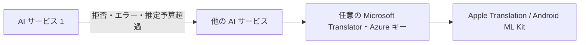

[AY Translate](https://github.com/AtlanYuey/AY_Translate) と同様に、DeepSeek、Gemini、OpenAI、Qwen、SiliconFlow、Kimi、Zhipu、OpenRouter、任意の OpenAI 互換サービスを設定できます。キーを貼り付けるとモデル一覧を取得し、翻訳テスト、パラメーターのプリセットや独自 JSON、単価・推定月額上限を指定できます。キーは端末のキーチェーンまたは暗号化領域に保存し、サービスが切り替わると通知します。

タイトルは翻訳文に置き換え、タップで原文へ戻せます。タグは EhTagTranslation の中国語データを週次更新し、ホームのカードにも適用します。

### 7. サイトの制限を尊重

nhentai の API 制限と E-Hentai のアクセス制限に合わせ、サイトごとの共通レート制限を設けています。長い待機では再開までの秒数を表示します。E-Hentai の IP ブロックを避けるため解除スイッチは設けません。両サイト同時検索も既定では無効です。同時ダウンロード数、再試行、ページ間隔は調整でき、E-Hentai は最大 3 ページ同時です。

### 8. プライバシー表示

アプリ切り替え画面では、画像のみ・画像と文字・画面全体のぼかし、または単色での覆いを選べます。既定は画像のみです。「画像と文字」でも設定などの操作部は読めます。Face ID、Touch ID、指紋、端末の認証によるロックに対応し、使用中も表紙をぼかせます。

## 機能の詳細

<details>
<summary><b>ホームと検索</b></summary>

- nhentai は新着と今日・週間・月間・全期間の人気作品、E-Hentai は新着・人気・ウォッチと昨日・月間・年間・全期間のランキングに対応します。
- 固定おすすめは最大 2 行で、一緒に読み込み表示します。既定は nhentai が現在の人気＋週間人気、E-Hentai が昨日のランキング＋現在の人気です。
- Masonry、コンパクト Masonry、グリッド、リスト。カードサイズは縦横別に設定でき、分割表示やステージマネージャに合わせて列数が変わります。
- カードのタグ表示と翻訳、言語フィルター、nhentai のランダムボタン。
- 検索は現在のサイトが基本で、同時検索も選択できます。サイトを切り替えると対応する検索構文を変換し、未対応の条件を示します。
- 数字だけなら該当 nhentai 作品を通常の検索結果の上に表示し、E-Hentai / ExHentai のリンクならその作品を表示します。アプリ復帰時にクリップボードの作品リンクを開くか確認できます。
- ローカルのタグ補完、サイト付きの共通検索履歴。履歴の保存は無効にできます。
</details>

<details>
<summary><b>作品詳細</b></summary>

- 表紙、翻訳・原文タイトル、作者、分類、E-Hentai の評価操作。読む、続きから読む、お気に入り、ダウンロード。
- ページ数、お気に入り数、公開日、サイズまたは番号の情報。
- 名前空間別のタグ。タップで検索、長押しでコピー。E-Hentai では投票やタグ追加も可能です。
- サムネイル、先頭と直前の位置を往復するページ見出し、右寄せの「すべて」ボタン。
- 別言語・別版と類似作品。nhentai は公式おすすめを使い、E-Hentai は作者/サークル、原作＋キャラクター、テーマの順で検索します。
- 両サイトでコメント投稿。E-Hentai は投票、コピー、投稿者ブロックにも対応し、翻訳とフィルターも使えます。
- E-Hentai 専用のフォルダー・メモ、Torrent、GP を使う公式アーカイブ、ブラウザーで開く操作。
</details>

<details>
<summary><b>リーダー</b></summary>

- 左→右、右→左、上→下、連続 Webtoon、間隔付き連続読み。
- 横画面のみ、または常時の見開き。表紙を単独表示し、1 ページずつずらすこともできます。中央間隔は任意で、既定 6 pt、2～60 pt に調整可能です。
- 白い余白の自動除去、自動ページ送りの間隔、後続ページの先読み。
- 速度調整付きの自動スクロール。3 秒/画面以下は赤い速度警告を表示します。「スワイプ中も自動スクロールを続ける」設定は速度の下にあり、既定では無効です。
- 連続読みでは画面下の次の 2 枚、ページ送りでは次の 2 面（見開きでは最大 4 枚）を先にデコードします。この処理は常に有効です。先読みページ数の設定では、先にダウンロードするページ数を調整できます。
- ページ送りアニメーションは無効化可能で、その場合はフェードを使います。ページを指に追従させず、スワイプ方向に柔らかく切り替えるモードもあります。
- 左右または上下のタップ領域、読み方向と直交する長いスワイプによる終了・操作表示・自動送り、ピンチとダブルタップで拡大。
- 点灯維持はオフ・5 分・10 分・常時。超解像はオフ・自動・常時で、追加モデルにも対応します。
- ページだけの明るさ・グレースケール・反転。ページ指定、単ページ保存・共有、Android の音量キーによるページ送り。
- 操作部は無操作後に自動で隠れます。設定は閲覧・表示・操作の 3 区分です。
</details>

<details>
<summary><b>お気に入り・履歴・ダウンロード</b></summary>

- 両サイトのアカウントのお気に入りを端末に保存し、日時順に統合してオフライン閲覧できます。nhentai は登録日時を返さないため、初回は順序を保持し、その後新しく見つかったものから時刻を記録します。
- サイト別、E-Hentai の 10 フォルダー別、全体に表示するフォルダーの選択と検索。追加・解除が失敗すると表示を元に戻します。
- 履歴は日付別で、サイト絞り込み、検索、読書進捗に対応します。
- ダウンロードは状態別に統合し、複数選択・一時停止・再開・削除・CBZ 書き出しが可能です。共有やファイル/ダウンロードフォルダーへの保存に対応します。
- 同時作品数・ページ数、再試行、待ち時間、原寸画像を設定でき、履歴とダウンロードはカード/リストを選べます。
</details>

<details>
<summary><b>アカウントとフィルター</b></summary>

- 各サイトで複数アカウントを切り替えられます。E-Hentai は EH の文字アバターを使います。
- nhentai はアカウントまたは API キーでログインし、アカウントのタグブラックリストも利用できます。
- E-Hentai は Web または Cookie ログイン、ExHentai 用の `igneous`、権限確認、画像割り当て・GP、サイト設定・My Tags ページに対応します。
- タグ、タイトル、正規表現を両サイトで共有。タグのルールは名前空間を無視し、nhentai の `tag:` と E-Hentai の `female:` / `male:` などを共通で扱えます。
- 該当作品をホームと検索から非表示にし、nhentai 側のブラックリストも補助として使います。ブロックしたコメント投稿者は全作品で非表示になります。
</details>

<details>
<summary><b>同期・バックアップ・その他</b></summary>

- WebDAV で設定、履歴、お気に入りのコピーを Android と iPhone 間で同期します。Nextcloud、NAS、アプリ用パスワードを使う Jianguoyun などに対応し、起動時・バックグラウンド移行時の自動同期も可能です。
- ETag 対応サーバーでは、送信前に他の端末による変更を確認してマージします。競合が続く場合は後で再試行するよう表示し、強制上書きしません。ETag 非対応ではこの保護がないため、同時同期を避けてください。
- 同期されたお気に入りは、その端末で現在のアカウントのサイト側お気に入りを一度すべて取得するまで隠し、別アカウントのコピーが混ざるのを防ぎます。
- iCloud は Apple アカウントで iOS 設定を同期します。iPhone と iPad で共有するか同じ種類の端末間だけにするか、列数も同期するかを選べます。
- 設定ファイルの書き出し/読み込み。Android のシステムバックアップ対象は設定のみです。履歴・お気に入りのコピーは WebDAV、ダウンロードしたファイルは端末内に保存します。
- 最新の正式版と開発版の確認。診断ログは現在の起動中に発生した通信・翻訳・同期エラーを記録し、認識できる Token、Cookie、キー、パスワードの形式を除去します。共有前にも内容を確認してください。
- システム追従・ライト・ダーク、アクセント色、スクロール時の上下バー非表示や下部バーの小さなボタン化。
- アプリ個別の言語設定：中国語簡体字/繁体字、英語、日本語、韓国語、スペイン語、フランス語、ドイツ語、イタリア語、ブラジルポルトガル語、ロシア語、ベトナム語、タイ語、インドネシア語。
</details>

<a id="usage"></a>
## 使い方

### インストール

正式版は [Releases](https://github.com/AtlanYuey/AENHT/releases/latest)、継続更新版は [dev-latest](https://github.com/AtlanYuey/AENHT/releases/tag/dev-latest) から取得できます。**情報 › アップデートを確認**に両方のリンクがあります。

| プラットフォーム | ファイル | 要件 |
| --- | --- | --- |
| Android | `.apk` | Android 10 以降 |
| iPhone / iPad | `.ipa` | iOS / iPadOS 18 以降、26 推奨 |

Android は APK をインストールします。正式版は同じ証明書で署名するため上書き更新できます。0.1.0 より前のテスト版からは一度アンインストールが必要です。公開 IPA は未署名です。AltStore、SideStore、Sideloadly などを使い、自分の Apple ID で署名してインストールしてください。

### 初回起動

1. 最初は nhentai のホームが表示されます。上部のサイト名で E-Hentai に切り替えます。
2. **マイページ › サイト**で有効なサイトと各ページの初期表示を選びます。
3. 閲覧・検索・読書・ダウンロードはログインなしで使えます。アカウントのお気に入り、コメント、ExHentai にはログインが必要です。
   - nhentai：**マイページ › アカウント › nhentai › ログイン**。または nhentai.net › Settings › API Keys でキーを作り、API キーのログインを選びます。
   - E-Hentai：**マイページ › アカウント › E-Hentai › ログイン**。Web ログインに失敗する場合は、ログイン済みブラウザーから `ipb_member_id`、`ipb_pass_hash`、必要に応じて `igneous` をコピーし、Cookie ログインを使います。
   - ExHentai の権限がある場合は、E-Hentai のアカウント画面またはサイト設定から有効にします。

### 翻訳と同期の設定

- タグの中国語訳は**外観**のタグ翻訳設定で有効にします。
- タイトル・コメントは**マイページ › 翻訳**で AI サービスを追加し、プロバイダーとキーを設定します。モデル取得後にテストし、ドラッグで使用順を変えられます。
- キーがない場合は端末内翻訳を使います。初回は言語パックを取得し、iOS はシステムで案内、Android は言語あたり約 30 MB です。
- **マイページ › WebDAV 同期**で URL・ユーザー名・パスワードを入力して接続します。サーバーの `AENHT` フォルダーに保存します。
- **マイページ › iCloud同期**には iCloud 権限付きの署名が必要です。サイドロード署名には含まれないことが多いため、設定ファイルの書き出し/読み込みも利用できます。

### ジェスチャー早見表

| 場所 | 操作 | 動作 |
| --- | --- | --- |
| 下部バー | タップ / 再タップ / 素早いダブルタップ | 先頭 / 直前の位置 / 更新 |
| ページ見出し | タップ / 再タップ | 最初のページ / 直前の位置 |
| 翻訳済みタイトル | タップ | 原文・訳文切り替え |
| タグ | タップ / 長押し | 検索 / コピー |
| E-Hentai コメント | 長押し | 投票・コピー・ブロック |
| リーダー | タップ領域 / 中央 | ページ送り / 操作部を表示 |
| リーダー | 読み方向と直交する長いスワイプ | 設定に応じた終了・操作表示・自動送り |
| リーダー | ピンチ / ダブルタップ | 拡大 |

## プロジェクト構成

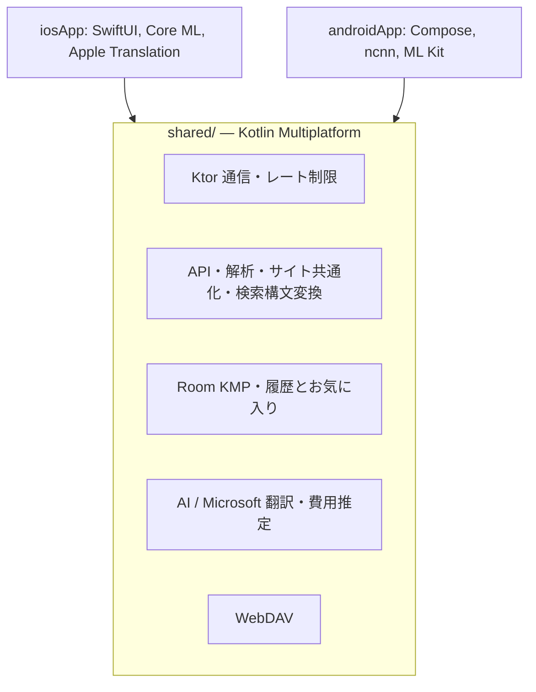

| ディレクトリ | 内容 |
| --- | --- |
| `shared/` | 通信、サイト共通化、解析、DB、同期、翻訳、制限、テスト |
| `androidApp/` | Kotlin/Compose アプリと Roborazzi スクリーンショットテスト |
| `iosApp/` | SwiftUI アプリ。XcodeGen で Xcode プロジェクトを生成 |
| `models/sr/` | ncnn / Core ML の高品質モデル |
| `tools/` | 翻訳文面 `i18n/`、アイコン `icon/`、モデル変換 `sr/` |
| `design/` | アイコンのデザイン |
| `docs/` | 要件、iOS 署名手順、README 画像 |

主な依存関係：Kotlin 2.4、Ktor 3、Room KMP、Ksoup、kotlinx.serialization、Compose、Coil 3、Nuke。

<a id="build"></a>
## ソースからビルド

**Android：** JDK 21 と Android SDK が必要です。

```bash
./gradlew :androidApp:assembleDebug
```

**iOS：** macOS、Xcode 26、XcodeGen、JDK 21 が必要です。Xcode のビルド時に Gradle が共通フレームワークを生成します。

```bash
cd iosApp
xcodegen generate
open AENHT.xcodeproj
```

**テスト：**

```bash
./gradlew :shared:jvmTest :androidApp:testDebugUnitTest
```

スクリーンショット出力先は `androidApp/build/screens/` です。`main` / `dev` への push で GitHub Actions が APK と IPA を作り、`dev` は `dev-latest` を更新します。Release 公開時はそのタグをビルドし、署名済み APK と未署名 IPA を添付します。[iOS 署名手順](docs/ios-signing.md)も参照してください。

## ロードマップ

- [x] 両サイトの閲覧・検索・読書・ダウンロード
- [x] お気に入り・履歴・ダウンロードの統合
- [x] AI・Microsoft・端末内のタイトル/コメント翻訳とタグ翻訳
- [x] Real-ESRGAN アニメモデルによる超解像の初期実装
- [x] WebDAV と iCloud 同期
- ❌ **漫画ページの翻訳（画像内の文字認識と翻訳）：当面対応予定はありません。** 漫画全体を翻訳すると Token の消費量が大きくなるためです。iPhone / iPad では [AY-Translate](https://github.com/AtlanYuey/AY_Translate) を使い、スクリーンショットで現在のページだけを認識・翻訳できます。
- [ ] ログイン不要のローカルお気に入り
- [ ] AEros-NHT からのデータ移行
- [ ] 統合お気に入りの公開日順表示

## ライセンスと謝辞

Apache License 2.0。詳しくは [LICENSE](LICENSE) と [NOTICE](NOTICE) を参照してください。[AtlanYuey](https://github.com/AtlanYuey) が保守しています。各サイトおよび以下のプロジェクトとは独立しています。

- [eros_n](https://github.com/honjow/eros_n)、honjow：AENHT の出発点。
- [AEros-NHT](https://github.com/AtlanYuey/AEros-NHT)：本アプリの旧版。
- [NextE](https://github.com/erosTeam/NextE) / [NextN](https://github.com/erosTeam/NextN)、erosTeam、MIT：機能の動作を参考にしており、ソースコードはコピーしていません。
- [AY Translate](https://github.com/AtlanYuey/AY_Translate)：AI サービスの設定。
- [nhentai_tags_fetcher](https://github.com/honjow/nhentai_tags_fetcher)、honjow：nhentai のタグデータ。
- [EhTagTranslation](https://github.com/EhTagTranslation/Database)、CC BY-NC-SA 3.0：タグの中国語訳。
- [LobeHub Icons](https://github.com/lobehub/lobe-icons)、MIT：AI プロバイダーのアイコン。
- [Real-ESRGAN](https://github.com/xinntao/Real-ESRGAN)、BSD-3-Clause：超解像モデル。

アプリの**情報 › オープンソースライセンス**に主要なライブラリ、データ、モデルのライセンスを掲載しています。18 歳以上の方のみ利用できます。
