<p align="center">
  <a href="README.md">简体中文</a> · <a href="README.en.md">English</a> ·
  <a href="README.es.md">Español</a> · <a href="README.ja.md">日本語</a> · <b>한국어</b>
</p>

<p align="center">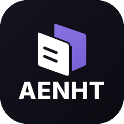</p>
<h1 align="center">AENHT</h1>
<p align="center">
  <b>All E-Hentai + nhentai HenTai</b><br>
  nhentai와 E-Hentai / ExHentai를 한 앱에서 이용하는 비공식 클라이언트<br>
  iPhone / iPad는 SwiftUI, Android는 Jetpack Compose 네이티브 UI를 사용하며 Kotlin Multiplatform으로 핵심 로직을 공유합니다
</p>
<p align="center">
  <a href="https://github.com/AtlanYuey/AENHT/releases/latest">정식 버전</a> ·
  <a href="https://github.com/AtlanYuey/AENHT/releases/tag/dev-latest">최신 수정본</a> ·
  <a href="#features">기능</a> · <a href="#design">설계</a> ·
  <a href="#usage">사용 방법</a> · <a href="#build">빌드</a>
</p>

> [!WARNING]
> 현재 버전은 0.2.5이며 개발이 진행 중입니다. 만 18세 이상만 이용할 수 있습니다.
> 이 프로젝트는 nhentai 및 E-Hentai와 관계가 없습니다.

<p align="center">
  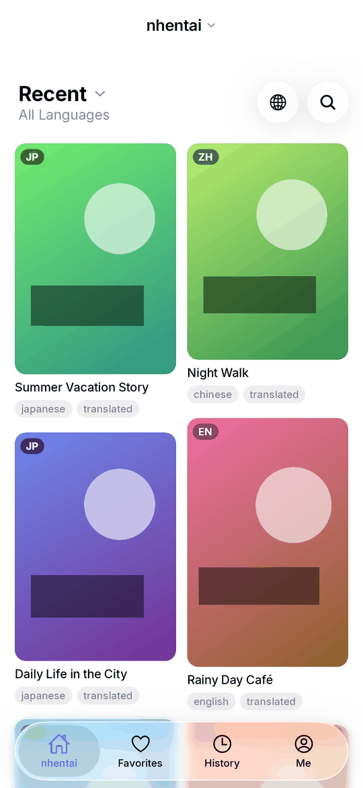
  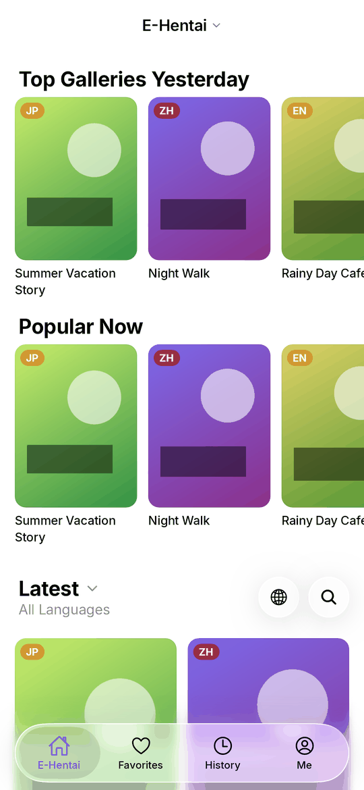
  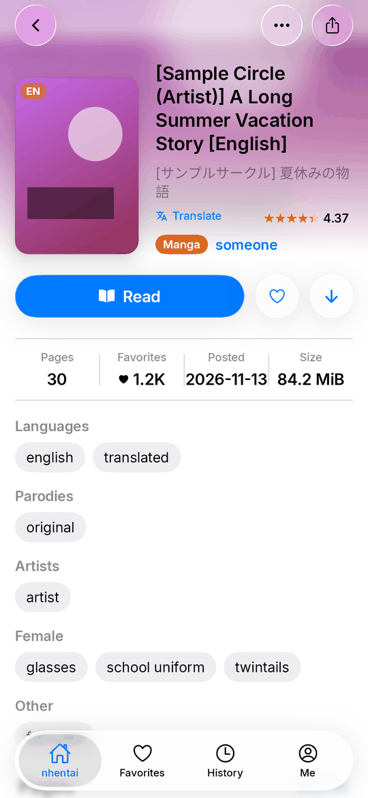
  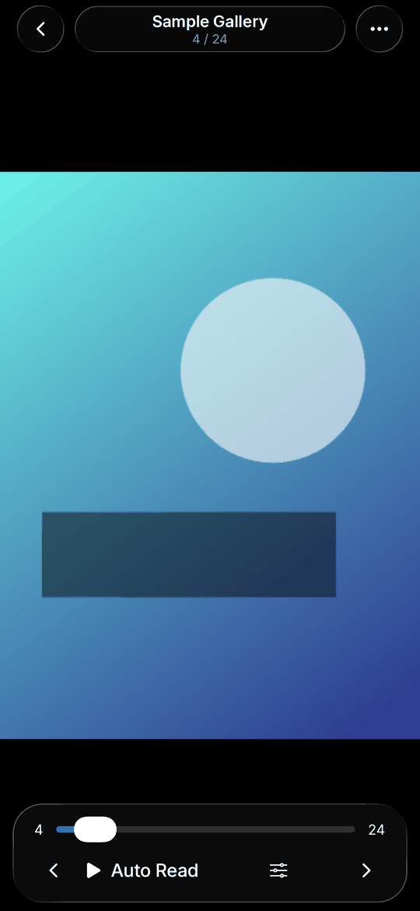
</p>
<p align="center"><sub>스크린샷은 Android UI 테스트에서 촬영했으며 표지와 제목은 예시 데이터입니다. iOS 버전도 같은 기본 화면 구성을 따릅니다.</sub></p>

## AENHT를 만든 이유

nhentai와 E-Hentai를 서로 다른 앱으로 이용하면 즐겨찾기, 기록, 설정도 따로 관리해야 합니다. AENHT는 두 사이트를 하나로 모읍니다.

- **두 사이트, 하나의 인터페이스:** 홈, 검색, 작품 상세, 리더의 구성을 통일했습니다.
- **즐겨찾기·기록·다운로드 통합:** 사이트 표시와 함께 한곳에 모아 보고, 사이트별로 필터링할 수 있습니다.
- **네이티브 UI:** iOS는 SwiftUI와 iOS 26의 Liquid Glass, Android는 Compose를 사용합니다.
- **공유 핵심 로직:** 네트워크, 파싱, 데이터베이스, 동기화, 번역, 요청 속도 제한을 Kotlin Multiplatform으로 공유합니다.

<a id="features"></a>
## 주요 기능

| | nhentai | E-Hentai / ExHentai |
| --- | :---: | :---: |
| 홈 | 최신, 오늘·이번 주·이번 달·전체 인기 | 최신, 인기, 구독 및 네 가지 순위 |
| 최대 두 줄의 고정 추천 | ✅ | ✅ |
| 검색·태그 문법·검색 기록 | ✅ | ✅ 사이트 변경 시 문법 변환 |
| 번호 또는 링크로 바로 열기 | 작품 번호 | 작품 링크 |
| 상세 정보·태그·페이지 미리보기·댓글 | ✅ | ✅ 평점·토렌트·아카이브 추가 |
| 다른 언어 및 판본 | ✅ | ✅ |
| 비슷한 작품 | ✅ | ✅ |
| 계정 즐겨찾기를 로컬에 동기화 | ✅ | ✅ 폴더 10개와 메모 |
| 댓글 | 작성 | 작성·투표·작성자 차단 |
| 계정 | 로그인·API 키·여러 계정 | 웹 로그인·쿠키·ExHentai·여러 계정 |
| 사이트 측 차단 | 계정 태그 차단 목록 | My Tags 웹 페이지 |
| 다운로드 | ✅ | ✅ 원본 이미지·공식 아카이브 추가 |
| 태그 투표 및 추가 | — | ✅ |
| 이미지 할당량과 GP | — | ✅ |

두 사이트의 공통 기능:

- **리더:** 읽기 방향, 두 페이지 보기, 자동 여백 자르기, 자동 페이지 넘김, 속도 조절 연속 자동 스크롤, 초해상도, 터치 영역과 제스처, 화면 켜짐 유지, 밝기·흑백·색상 반전.
- **태블릿:** iPad와 Android 태블릿의 가로 화면에서 홈·작품 페이지·마이페이지의 태블릿 배치를 각각 설정할 수 있습니다.
- **외부 기기:** Apple Pencil(이중 탭·스퀴즈), Galaxy S Pen 에어 액션을 포함한 Android 스타일러스, Surface 펜 같은 Windows 펜, 키보드와 블루투스 페이지 넘김 리모컨으로 페이지를 넘길 수 있습니다. 설정은 기기를 연결하거나 사용했을 때 나타납니다.
- **번역:** 태그 중국어 번역, AI·Microsoft Translator·기기 내 번역을 통한 제목 및 댓글 번역.
- **필터:** 태그·제목·정규식 규칙을 두 사이트에 함께 적용합니다.
- **동기화:** iOS와 Android 간 WebDAV, iOS 설정의 iCloud 동기화.
- **개인정보 보호:** 앱 잠금, 백그라운드 화면 보호, 진단 로그.
- **UI 언어:** 14개 언어.

## 스크린샷

<table>
  <tr>
    <td align="center"><br><sub>nhentai 홈</sub></td>
    <td align="center"><br><sub>E-Hentai 홈과 순위</sub></td>
    <td align="center">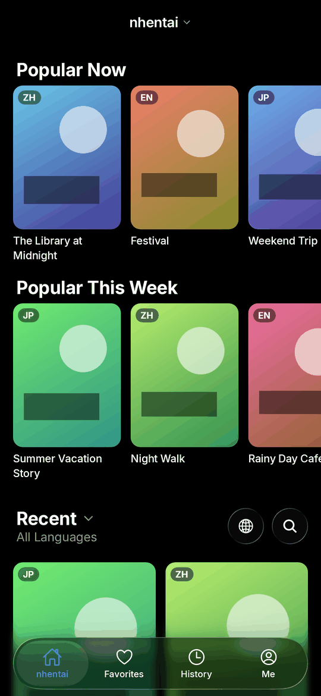<br><sub>다크 모드와 고정 추천</sub></td>
    <td align="center">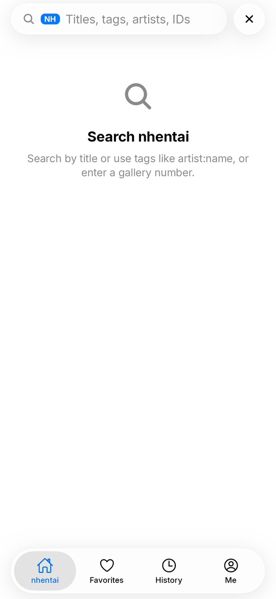<br><sub>검색</sub></td>
  </tr>
  <tr>
    <td align="center">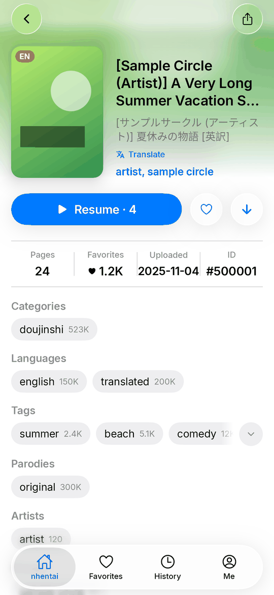<br><sub>nhentai 작품 상세</sub></td>
    <td align="center"><br><sub>E-Hentai 작품 상세</sub></td>
    <td align="center"><br><sub>리더</sub></td>
    <td align="center">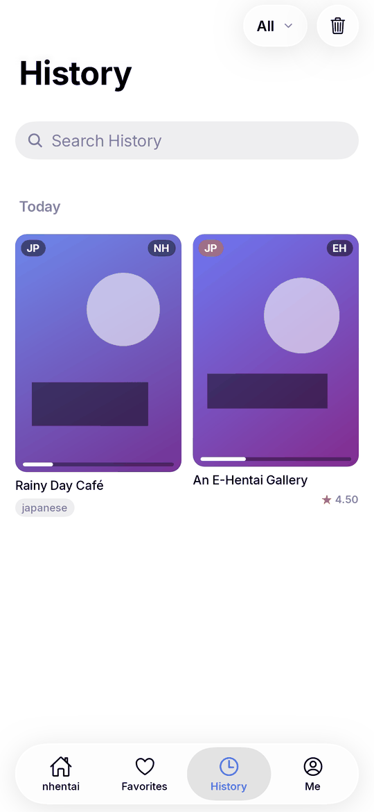<br><sub>통합 기록</sub></td>
  </tr>
  <tr>
    <td align="center">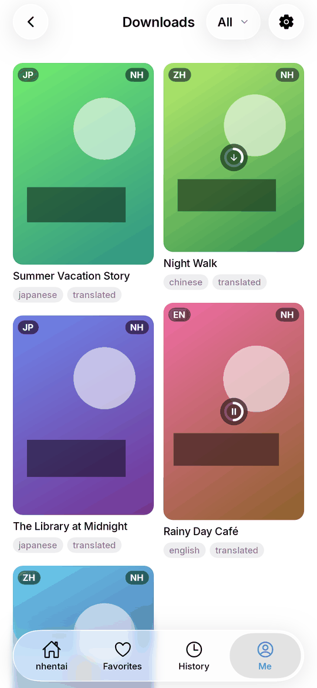<br><sub>다운로드</sub></td>
    <td align="center">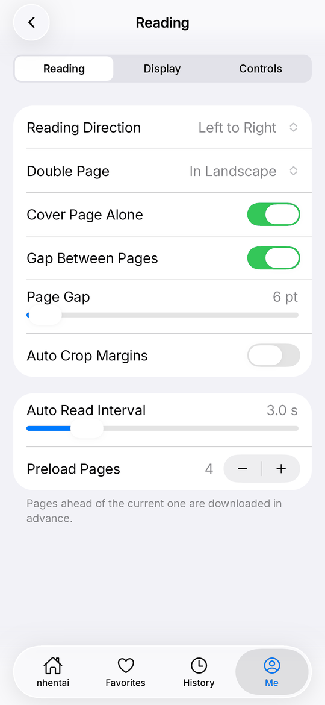<br><sub>읽기 설정</sub></td>
    <td align="center">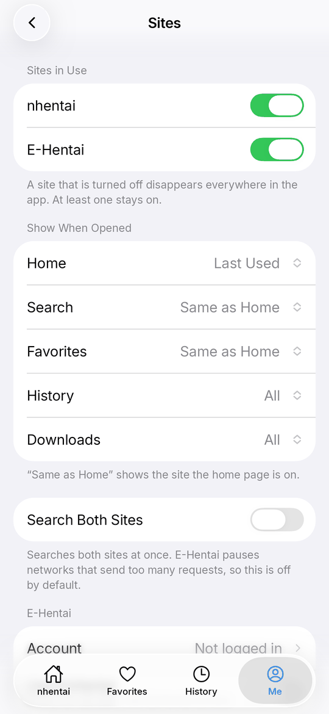<br><sub>사이트 설정</sub></td>
    <td align="center">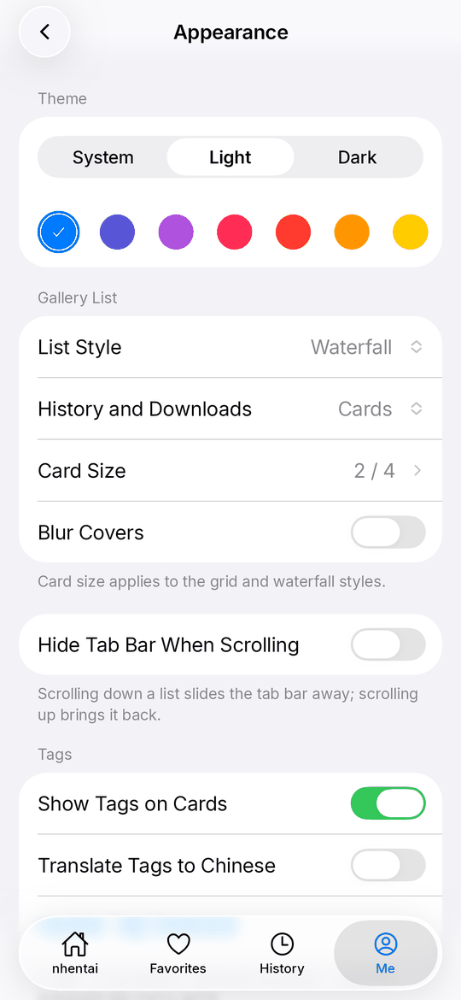<br><sub>화면 스타일</sub></td>
  </tr>
  <tr>
    <td align="center">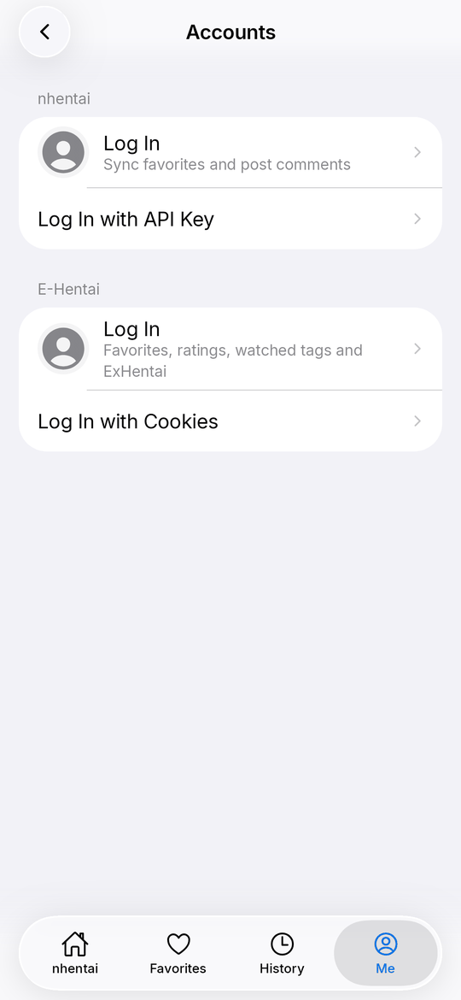<br><sub>계정</sub></td>
    <td align="center">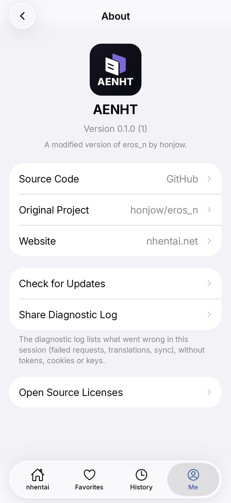<br><sub>앱 정보</sub></td>
    <td align="center" colspan="2">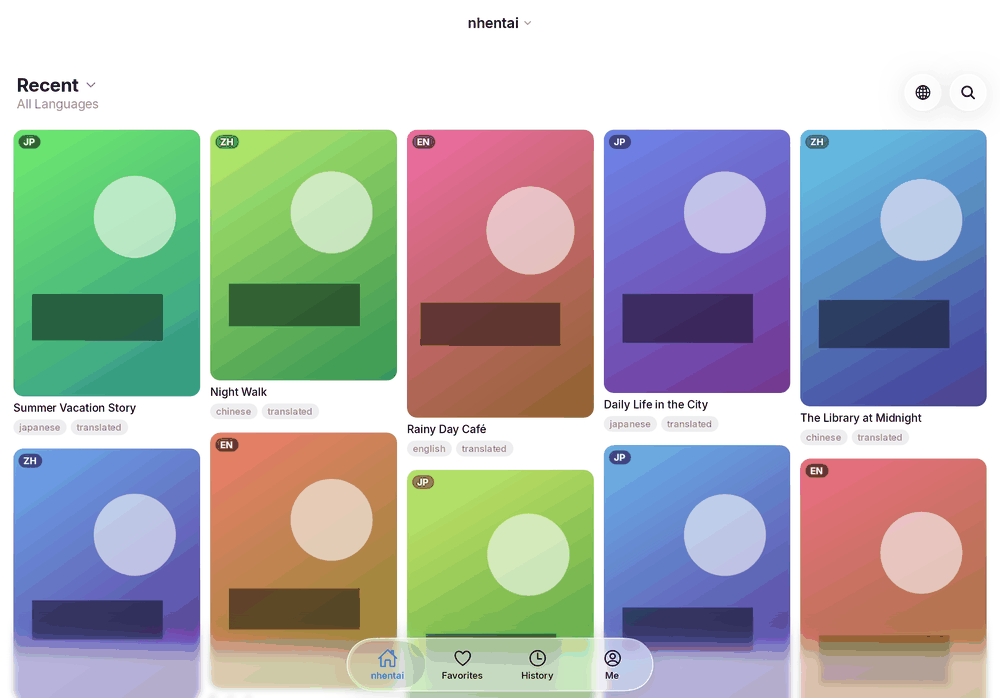<br><sub>태블릿 가로 화면</sub></td>
  </tr>
</table>

<a id="design"></a>
## 설계 방향

### 1. 두 사이트에 같은 화면 구성

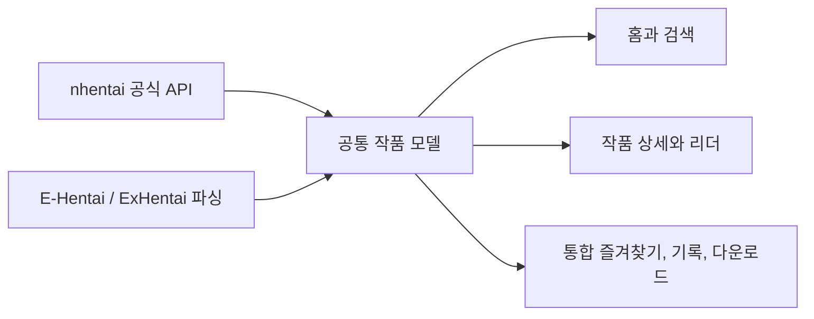

각 사이트의 데이터를 공통 모델로 변환합니다. 상세 화면은 정보 → 태그 → 페이지 → 다른 판본 → 비슷한 작품 → 댓글 순서를 유지하고, E-Hentai의 평점·토렌트·아카이브 같은 전용 기능은 그 안의 적절한 위치에 배치합니다.

- ExHentai는 별도의 세 번째 사이트가 아니라 E-Hentai의 옵션입니다. **마이페이지 › 사이트**에서 E-Hentai를 켜면 옆에 전환 항목이 표시되며 표지에는 EX 표시가 붙습니다.
- 각 화면의 시작 사이트를 마지막 선택, 홈과 동일, nhentai, E-Hentai 또는 전체로 지정할 수 있습니다. 관련 설정은 사이트 설정에 모았습니다.
- 카드 왼쪽 위는 언어 표시이며 색상은 작품 분류를 따릅니다. 두 사이트에서 같은 분류 색상을 쓰고, 통합 목록 오른쪽 위에는 NH 또는 EH를 표시합니다.

### 2. 간결한 상단 영역

- 가운데 유리 효과의 사이트 이름 버튼으로 사이트를 바꿉니다. 사이트가 하나만 켜져 있으면 화살표는 숨깁니다.
- nhentai 무작위 작품은 오른쪽 위 주사위 버튼입니다.
- 아래에는 정렬 기준과 언어, 언어 및 검색 버튼을 표시합니다. 아래로 스크롤하면 상단 바로 이동하고 맨 위로 돌아오면 원위치로 복귀합니다.
- 버튼은 다크 모드에서 흰색, 라이트 모드에서 검은색입니다. 검색은 현재 화면에서 펼쳐지며 사이트 전환은 검색창 아래에 있습니다.
- 즐겨찾기 제목도 메뉴로 동작하여 전체·사이트별·E-Hentai 폴더를 선택할 수 있습니다.

### 3. 하단 바 터치 동작

| 동작 | 홈 / 즐겨찾기 / 기록 | 마이페이지 |
| --- | --- | --- |
| 한 번 누르기 | 맨 위로 | 한 단계 뒤로 |
| 다시 누르기 | 이전 위치로 | 한 단계 더 뒤로 |
| 빠르게 두 번 누르기 | 새로고침 | — |

작품 상세의 **페이지** 제목도 첫 페이지와 이전 위치를 오갑니다. iPad에서는 하단 바가 마지막으로 터치한 쪽으로 이동할 수 있으며 속도는 세 단계입니다. 왼쪽·가운데·오른쪽 고정도 지원합니다.

### 4. 리더 전환과 태블릿 배치

- 미리보기 이미지가 확대되며 리더가 열리고, 닫을 때는 **현재 읽던 페이지**의 미리보기로 돌아갑니다. 페이지 행도 해당 위치를 가운데로 맞춥니다.
- 터치 영역이 좌우라면 세로 제스처로 종료·컨트롤 표시·자동 읽기를 설정하고, 영역이 위아래라면 이 제스처를 가로 방향에 배치합니다. 읽기 방향의 스와이프는 계속 페이지 넘김으로 사용합니다.
- 화면 켜짐 유지는 마지막 터치부터 기본 5분이며, 이후 시스템 자동 잠금으로 돌아갑니다. 시스템보다 먼저 화면을 끄지 않습니다.
- 두 페이지 중앙 간격은 기본 6 pt입니다. 페이지 간격 설정은 간격이 있는 연속 읽기에서만 조정합니다.
- 태블릿 가로 화면은 작품 정보와 페이지 목록을 좌우로, 추천을 두 열로 배치합니다. 마이페이지는 목록과 상세의 두 영역이며 계정, 다운로드, 기록·즐겨찾기 수, 동기화, 버전을 요약합니다. 경계에 걸친 표지도 모서리 곡률을 유지하고 iOS 26에서는 부드러운 그라데이션 흐림을 사용합니다. 각 항목은 '마이페이지 › 태블릿 레이아웃'에서 끌 수 있습니다. 작품 페이지 오른쪽에는 페이지 목록(절반 또는 좁은 3열)이나 다른 버전·비슷한 작품·댓글을 표시하며, 페이지 목록은 읽고 있는 페이지를 따라갑니다.
- 회전할 때 보고 있던 카드 위치를 유지합니다. iOS 작품 목록은 UICollectionView를 사용합니다.

### 5. 필요할 때만 초해상도

Real-ESRGAN 애니메이션용 모델을 iOS에서는 Core ML, Android에서는 ncnn으로 기기 내 실행합니다. 원본을 먼저 표시하고 처리가 끝나면 교체합니다. 자동 모드는 표시 영역보다 확실히 작은 이미지를 대상으로 합니다. 초해상도를 켜면 현재 표시 중인 페이지를 우선 처리하고, 조건을 충족하는 다음 이미지도 미리 처리합니다. 기본 모델은 포함되어 있고 고품질 모델은 설정에서 추가로 다운로드할 수 있습니다.

### 6. 번역 대체 경로

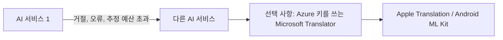

[AY Translate](https://github.com/AtlanYuey/AY_Translate)와 같은 방식으로 DeepSeek, Gemini, OpenAI, Qwen, SiliconFlow, Kimi, Zhipu, OpenRouter 및 OpenAI 호환 서비스를 설정합니다. 키를 붙여 넣으면 모델 목록을 가져오며, 번역 테스트, 매개변수 프리셋 또는 사용자 JSON, 단가와 월간 추정 지출 한도를 지정할 수 있습니다. 키는 기기 키체인 또는 암호화 저장소에 보관하고 서비스가 바뀌면 알림을 표시합니다.

번역한 제목은 원문을 대신 표시하며 누르면 원문으로 전환됩니다. 태그는 EhTagTranslation의 중국어 데이터를 주 단위로 갱신하고 홈 카드에도 적용합니다.

### 7. 사이트의 요청 제한 준수

nhentai API 제한과 E-Hentai의 허용 요청량에 맞춰 사이트별 공통 제한을 둡니다. 대기 시간이 길면 남은 시간을 표시합니다. E-Hentai IP 차단을 줄이기 위해 제한 해제 스위치는 제공하지 않으며 두 사이트 동시 검색도 기본으로 꺼져 있습니다. 다운로드 동시 수, 재시도, 페이지 간 대기는 조절할 수 있고 E-Hentai는 최대 세 페이지를 동시에 다운로드합니다.

### 8. 개인정보 보호 수준

앱 전환 화면에서 이미지만 흐리기, 이미지와 글자 흐리기, 앱 전체 흐리기, 단색으로 가리기를 선택할 수 있습니다. 기본값은 이미지만 흐리기이며, 이미지와 글자를 흐리는 모드에서도 설정 컨트롤은 읽을 수 있습니다. Face ID, Touch ID, 지문, 기기 인증을 지원하는 앱 잠금이 있고 앱 사용 중에도 표지를 흐릴 수 있습니다.

## 기능 상세

<details>
<summary><b>홈과 검색</b></summary>

- nhentai는 최신과 오늘·이번 주·이번 달·전체 인기, E-Hentai는 최신·인기·구독과 어제·이번 달·올해·전체 순위를 지원합니다.
- 최대 두 줄의 고정 추천이 함께 로드되어 표시됩니다. 기본값은 nhentai의 현재 인기+주간 인기, E-Hentai의 어제 순위+현재 인기입니다.
- Masonry, 간결한 Masonry, 격자, 목록. 세로·가로 카드 크기를 따로 설정하고 분할 화면과 스테이지 매니저에 맞춰 열 수가 바뀝니다.
- 번역 가능한 카드 태그, 언어 필터, nhentai 무작위 버튼.
- 검색은 현재 사이트가 기본이며 두 사이트 검색도 선택할 수 있습니다. 사이트 변경 시 지원하는 문법을 변환하고 적용할 수 없는 조건은 알려 줍니다.
- 숫자만 입력하면 해당 nhentai 작품을 일반 검색 결과 위에 표시하며, E-Hentai / ExHentai 링크도 바로 열 수 있습니다. 앱 복귀 시 클립보드의 작품 링크를 열지 물을 수 있습니다.
- 로컬 태그 자동 완성과 사이트 표시가 있는 공통 검색 기록. 기록 저장은 끌 수 있습니다.
</details>

<details>
<summary><b>작품 상세</b></summary>

- 표지, 번역·원문 제목, 작가, 분류, E-Hentai 평점 조작. 읽기·이어서 읽기·즐겨찾기·다운로드.
- 페이지 수, 즐겨찾기 수, 게시일, 크기 또는 작품 번호.
- 이름 공간별 태그: 누르면 검색, 길게 누르면 복사합니다. E-Hentai는 투표와 추가도 지원합니다.
- 페이지 미리보기, 첫 페이지와 이전 위치를 오가는 페이지 제목, 오른쪽의 전체 버튼.
- 다른 번역·판본과 비슷한 작품. nhentai는 공식 추천, E-Hentai는 작가/서클, 원작+캐릭터, 주제 조합 순서로 검색합니다.
- 양쪽 사이트에서 댓글을 작성할 수 있습니다. E-Hentai에서는 투표·복사·작성자 차단도 가능하며 번역과 필터를 적용합니다.
- E-Hentai 전용 즐겨찾기 폴더·메모, 토렌트, GP를 사용하는 공식 아카이브와 브라우저 열기.
</details>

<details>
<summary><b>리더</b></summary>

- 왼쪽→오른쪽, 오른쪽→왼쪽, 위→아래, 연속 Webtoon, 간격 조절 연속 읽기.
- 가로 화면 또는 항상 두 페이지 보기, 표지 단독 표시, 펼침 면을 한 페이지씩 이동, 선택 가능한 중앙 간격: 기본 6 pt, 2–60 pt 조절.
- 흰 여백 자동 자르기, 자동 넘김 간격, 다음 페이지 미리 불러오기.
- 연속 자동 스크롤의 속도를 조절할 수 있습니다. 화면당 3초 이하에서는 빨간 경고를 표시하며, 속도 아래의 스와이프 후 계속 스크롤하는 옵션은 기본으로 꺼져 있습니다.
- 연속 읽기에서는 화면 아래의 다음 이미지 두 장을, 페이지 넘기기에서는 다음 두 면(두 페이지 보기에서는 이미지 최대 네 장)을 미리 디코딩합니다. 이 기능은 항상 켜져 있으며, 미리 불러올 페이지 수 설정은 사전에 다운로드할 페이지 수를 조절합니다.
- 스와이프로 넘기기: 슬라이드 또는 스와이프 페이드(페이지는 그대로이고 부드러운 페이드 경계가 손가락을 따라가며, 되돌리면 취소). 탭으로 넘기기: 슬라이드, 전체 페이드, 퍼지는 페이드(누른 위치에서 퍼짐).
- 페이지 크기: 핀치로 확대하고 한 손가락으로 이동(관성 포함). 확대 중에는 넘기거나 닫히지 않으며 하단에 '크기 재설정'이 나타납니다. 페이지 넘기기 모드에서는 화면보다 작게 줄일 수도 있습니다. 연속 읽기는 기본으로 한 페이지 전체가 보이는 너비로 표시하고, 핀치로 너비를 바꾸며 '페이지 크기 유지'로 기억합니다.
- 상단 제목을 두 번 누르면 첫 페이지로 이동합니다. 리더에서는 상태 표시줄을 눌러도 이동하지 않습니다.
- Apple Pencil(iPad): 화면에서 뗀 채 이중 탭 또는 스퀴즈(Pro). 세대는 iPad 모델과 받은 제스처로 추정합니다. Android 스타일러스: 펜 버튼·두 번째 버튼·펜 끝 버튼을 각각 설정, Galaxy S Pen 에어 액션 지원. Windows 펜(Surface 펜): 윗부분 버튼. 키보드와 블루투스 페이지 넘김 리모컨: 화살표·Page Up / Down·스페이스(연속 읽기에서는 한 화면씩).
- 좌우 또는 상하 터치 영역, 읽기 방향과 수직인 긴 스와이프로 종료·컨트롤·자동 읽기 실행, 핀치와 두 번 누르기로 확대.
- 화면 켜짐: 끄기·5분·10분·항상. 초해상도: 끄기·자동·항상 및 추가 모델 다운로드.
- 페이지에만 적용되는 밝기·흑백·색상 반전, 페이지 이동·저장·공유, Android 볼륨 키 넘김.
- 일정 시간 조작이 없으면 컨트롤이 숨겨집니다. 컨트롤 바는 한 줄(현재 페이지·슬라이더·남은 페이지 수)이며, 슬라이더를 움직이면 앞뒤 페이지의 썸네일을 보여 줍니다. 리더 설정과 자동 넘김 버튼은 막대 좌우에 각각 따로 된 말풍선으로 놓입니다(서로 바꾸거나, 손 쪽을 따르게 하거나, 막대 위나 안에 둘 수도 있습니다). 자동 넘김 버튼은 오른쪽 아래에 항상 표시해 둘 수도 있습니다. 페이지를 길게 누르면 다시 불러올 수 있고, 불러오지 못한 페이지는 버튼을 눌러 다시 불러옵니다. 자동 넘김 버튼을 길게 누르면 속도를 조절할 수 있습니다. 가운데를 탭할 때만 컨트롤을 표시하도록 할 수도 있습니다. 설정은 읽기(방향·페이지 넘김·자동 읽기·미리 불러오기)·표시(필터·페이지 크기·초해상도·화면 켜짐)·조작(컨트롤 바·탭과 스와이프·키와 기기)으로 구분합니다.
</details>

<details>
<summary><b>즐겨찾기·기록·다운로드</b></summary>

- 두 계정의 즐겨찾기를 로컬에 저장하고 등록 시간순으로 모아 오프라인에서 볼 수 있습니다. nhentai는 등록 시간을 제공하지 않으므로 최초 순서를 유지하고 이후 새로 발견한 항목부터 시간을 기록합니다.
- 사이트별, E-Hentai의 10개 폴더별 필터와 전체에 표시할 폴더 선택, 즐겨찾기 검색. 추가·해제가 실패하면 이전 상태로 되돌립니다. 탭을 열면 자동으로 새로 고치며(아래로 스크롤한 경우 제외), 여러 개를 선택해 사이트에서도 한 번에 제거할 수 있습니다.
- 통합 기록은 날짜별로 나누며 사이트 필터, 검색, 읽기 진행률, 여러 개 선택 삭제를 지원합니다.
- 다운로드는 상태별로 모아 다중 선택·일시 정지·재개·삭제·CBZ 내보내기가 가능합니다. 공유하거나 파일/다운로드 폴더에 저장할 수 있습니다.
- 작품·페이지 동시 수, 재시도, 페이지 간 대기, 원본 이미지 다운로드를 설정하고 기록·다운로드에 카드 또는 목록을 선택합니다.
</details>

<details>
<summary><b>계정과 필터</b></summary>

- 사이트별 여러 계정을 누르기만 해서 바꿀 수 있으며 E-Hentai는 EH 글자 아바타를 사용합니다.
- nhentai는 계정 또는 API 키 로그인과 계정 태그 차단 목록을 지원합니다.
- E-Hentai는 웹·쿠키 로그인, ExHentai용 `igneous`, 접근 권한 확인, 이미지 할당량과 GP 비용, 사이트 설정 및 My Tags 페이지를 지원합니다.
- 공통 필터는 태그·제목·정규식을 지원합니다. 태그 규칙은 이름 공간을 무시하여 nhentai의 `tag:`와 E-Hentai의 `female:` / `male:` 등을 함께 처리합니다.
- 일치한 작품은 홈과 검색에서 숨깁니다. nhentai 계정 차단 목록이 이를 보완하며 차단한 댓글 작성자는 모든 작품에서 숨깁니다.
</details>

<details>
<summary><b>동기화·백업·기타 설정</b></summary>

- WebDAV로 설정, 기록, 즐겨찾기 사본을 Android와 iPhone 사이에 동기화합니다. Nextcloud, NAS, 앱 암호를 쓰는 Jianguoyun 등을 지원하고 시작·백그라운드 전환 시 자동 동기화할 수 있습니다.
- ETag 지원 서버에서는 업로드 전 다른 기기의 변경을 확인해 병합한 뒤 재시도합니다. 충돌이 계속되면 나중에 다시 시도하도록 알리고 덮어쓰지 않습니다. ETag가 없는 서버는 이 보호가 없으므로 동시 동기화를 피하세요.
- 동기화된 즐겨찾기는 이 기기에서 현재 계정의 사이트 즐겨찾기를 한 번 모두 가져올 때까지 숨겨 다른 계정의 사본이 표시되지 않게 합니다.
- iCloud는 Apple 계정으로 iOS 설정을 동기화합니다. iPhone/iPad 간 공유 또는 같은 종류의 기기끼리만 공유할 수 있고 열 수 동기화도 별도로 선택합니다.
- 설정 파일 내보내기/가져오기. Android 시스템 백업에는 설정만 포함되며 기록·즐겨찾기 사본은 WebDAV에 의존합니다. 다운로드한 파일은 기기에만 저장됩니다.
- 최신 정식·개발 버전 확인. 진단 로그는 현재 실행 중 실패한 요청·번역·동기화를 기록하고 인식 가능한 토큰·쿠키·키·암호 형식을 제거합니다. 공유 전에 내용을 확인하세요.
- 시스템·라이트·다크 스타일, 강조 색상, 스크롤할 때 상하 바 숨김과 하단 바를 작은 버튼으로 축소하는 옵션.
- 앱별 언어 선택: 중국어 간체·번체, 영어, 일본어, 한국어, 스페인어, 프랑스어, 독일어, 이탈리아어, 브라질 포르투갈어, 러시아어, 베트남어, 태국어, 인도네시아어.
</details>

<a id="usage"></a>
## 사용 방법

### 설치

정식 버전은 [Releases](https://github.com/AtlanYuey/AENHT/releases/latest), 지속 업데이트 버전은 [dev-latest](https://github.com/AtlanYuey/AENHT/releases/tag/dev-latest)에서 받습니다. **정보 › 업데이트 확인**에서 두 링크를 확인할 수 있습니다.

| 플랫폼 | 파일 | 요구 사항 |
| --- | --- | --- |
| Android | `.apk` | Android 10 이상 |
| iPhone / iPad | `.ipa` | iOS / iPadOS 18 이상, 26 권장 |

Android는 APK를 바로 설치합니다. 정식 버전은 같은 인증서로 서명하므로 덮어써서 업데이트할 수 있습니다. 0.1.0 이전 테스트 버전은 한 번 삭제해야 합니다. 공개 IPA는 서명되지 않았으므로 AltStore, SideStore, Sideloadly 등에서 자신의 Apple ID로 서명해 설치하세요.

### 처음 사용하기

1. 기본 화면은 nhentai 홈입니다. 위의 사이트 이름을 눌러 E-Hentai로 전환합니다.
2. **마이페이지 › 사이트**에서 사용할 사이트와 각 페이지의 시작 화면을 선택합니다.
3. 둘러보기·검색·읽기·다운로드에는 로그인이 필수가 아닙니다. 계정 즐겨찾기·댓글·ExHentai에는 필요합니다.
   - nhentai: **마이페이지 › 계정 › nhentai › 로그인** 또는 nhentai.net › Settings › API Keys에서 키를 만든 후 API 키 로그인을 선택합니다.
   - E-Hentai: **마이페이지 › 계정 › E-Hentai › 로그인**. 웹 로그인이 실패하면 로그인된 브라우저에서 `ipb_member_id`, `ipb_pass_hash`, 필요하면 `igneous`를 복사해 쿠키 로그인을 사용합니다. 복사한 내용(Cookie 헤더, 쿠키 확장 프로그램의 JSON, cookies.txt)은 자동으로 인식되어 채워집니다.
   - ExHentai 권한이 있으면 E-Hentai 계정 화면이나 사이트 설정에서 활성화합니다.

### 번역과 동기화 설정

- 태그 중국어 번역은 **화면 스타일**의 태그 번역 설정에서 켭니다.
- 제목·댓글은 **마이페이지 › 번역**에서 AI 서비스를 추가합니다. 제공 업체와 키를 설정하고 모델을 가져온 뒤 테스트하며, 드래그로 사용 순서를 바꿀 수 있습니다.
- 키가 없으면 기기 내 번역을 사용합니다. 처음에는 언어 팩을 다운로드하며 iOS는 시스템 안내를, Android는 언어당 약 30 MB를 사용합니다.
- **마이페이지 › WebDAV 동기화**에서 서버 URL과 계정 정보를 입력해 연결합니다. 데이터는 서버의 `AENHT` 폴더에 저장됩니다.
- **마이페이지 › iCloud 동기화**에는 iCloud 권한이 포함된 서명이 필요합니다. 사이드로드 서명에는 없는 경우가 많으므로 설정 파일 내보내기/가져오기를 대신 사용할 수 있습니다.

### 제스처 안내

| 위치 | 동작 | 결과 |
| --- | --- | --- |
| 하단 바 | 누르기 / 다시 누르기 / 빠르게 두 번 | 맨 위 / 이전 위치 / 새로고침 |
| 페이지 제목 | 누르기 / 다시 누르기 | 첫 페이지 / 이전 위치 |
| 번역된 제목 | 누르기 | 번역·원문 전환 |
| 태그 | 누르기 / 길게 누르기 | 검색 / 복사 |
| E-Hentai 댓글 | 길게 누르기 | 투표·복사·차단 |
| 리더 | 터치 영역 / 가운데 | 페이지 넘김 / 컨트롤 표시 |
| 리더 | 읽기 방향과 수직인 긴 스와이프 | 설정된 종료·컨트롤·자동 읽기 |
| 리더 | 핀치 / 두 번 누르기 | 확대 |
| 리더 | 제목 두 번 누르기 | 첫 페이지 |
| 리더 (iPad) | Apple Pencil 이중 탭 / 스퀴즈 | 다음 / 이전 페이지(변경 가능) |
| 리더 | 키보드·페이지 넘김 리모컨: → ↓ 스페이스 / ← ↑ | 다음 / 이전 페이지 |

## 프로젝트 구조

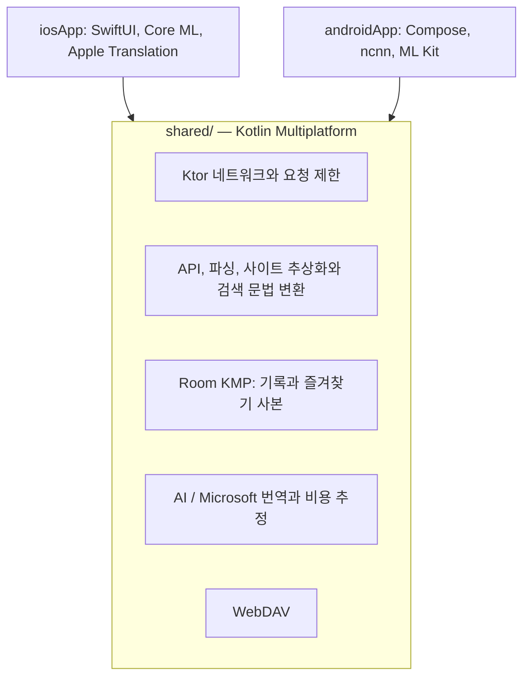

| 디렉터리 | 내용 |
| --- | --- |
| `shared/` | 네트워크, 사이트 추상화, 파싱, DB, 동기화, 번역, 제한, 테스트 |
| `androidApp/` | Kotlin/Compose 앱과 Roborazzi 스크린샷 테스트 |
| `iosApp/` | SwiftUI 앱. XcodeGen으로 Xcode 프로젝트 생성 |
| `models/sr/` | ncnn / Core ML 고품질 모델 |
| `tools/` | 다국어 문구 `i18n/`, 아이콘 `icon/`, 모델 변환 `sr/` |
| `design/` | 아이콘 디자인 |
| `docs/` | 요구 사항, iOS 서명 안내, README 이미지 |

주요 의존성: Kotlin 2.4, Ktor 3, Room KMP, Ksoup, kotlinx.serialization, Compose, Coil 3, Nuke.

<a id="build"></a>
## 소스에서 빌드하기

**Android:** JDK 21과 Android SDK가 필요합니다.

```bash
./gradlew :androidApp:assembleDebug
```

**iOS:** macOS, Xcode 26, XcodeGen, JDK 21이 필요합니다. Xcode 빌드 중 Gradle이 공유 프레임워크를 만듭니다.

```bash
cd iosApp
xcodegen generate
open AENHT.xcodeproj
```

**테스트:**

```bash
./gradlew :shared:jvmTest :androidApp:testDebugUnitTest
```

스크린샷 출력은 `androidApp/build/screens/`에 있습니다. `main` / `dev`에 푸시하면 GitHub Actions가 APK와 IPA를 빌드하고 `dev`는 `dev-latest`를 갱신합니다. Release를 게시하면 해당 태그를 빌드해 서명된 APK와 서명되지 않은 IPA를 첨부합니다. [iOS 서명 안내](docs/ios-signing.md)를 참고하세요.

## 로드맵

- [x] 두 사이트의 탐색·검색·읽기·다운로드
- [x] 즐겨찾기·기록·다운로드 통합
- [x] AI·Microsoft·기기 내 제목/댓글 번역과 태그 번역
- [x] Real-ESRGAN 애니메이션 모델을 이용한 초해상도 1차 구현
- [x] WebDAV와 iCloud 동기화
- [x] iPad와 Android 태블릿 배치
- [x] Apple Pencil·Android 스타일러스·Windows 펜·키보드·페이지 넘김 리모컨으로 페이지 넘기기
- ❌ **만화 페이지 번역(이미지 속 글자 인식 및 번역): 당분간 계획이 없습니다.** 만화 전체를 번역하면 토큰 소모가 너무 큽니다. iPhone / iPad에서는 [AY-Translate](https://github.com/AtlanYuey/AY_Translate)를 사용해 스크린샷으로 현재 페이지만 인식하고 번역할 수 있습니다.
- [ ] 로그인 없이 사용하는 로컬 즐겨찾기
- [ ] AEros-NHT 데이터 가져오기
- [ ] 통합 즐겨찾기를 게시일순으로 정렬

## 라이선스와 감사의 말

Apache License 2.0으로 배포합니다. [LICENSE](LICENSE)와 [NOTICE](NOTICE)를 확인하세요. [AtlanYuey](https://github.com/AtlanYuey)가 관리하며 해당 사이트 및 다음 프로젝트와는 독립적입니다.

- [eros_n](https://github.com/honjow/eros_n), honjow: AENHT의 출발점.
- [AEros-NHT](https://github.com/AtlanYuey/AEros-NHT): 이 앱의 이전 버전.
- [NextE](https://github.com/erosTeam/NextE) / [NextN](https://github.com/erosTeam/NextN), erosTeam, MIT: 기능 동작을 참고했으며 소스 코드는 복사하지 않았습니다.
- [AY Translate](https://github.com/AtlanYuey/AY_Translate): AI 서비스 설정.
- [nhentai_tags_fetcher](https://github.com/honjow/nhentai_tags_fetcher), honjow: nhentai 태그 데이터.
- [EhTagTranslation](https://github.com/EhTagTranslation/Database), CC BY-NC-SA 3.0: 중국어 태그 번역.
- [LobeHub Icons](https://github.com/lobehub/lobe-icons), MIT: AI 제공 업체 아이콘.
- [Real-ESRGAN](https://github.com/xinntao/Real-ESRGAN), BSD-3-Clause: 초해상도 모델.

앱의 **정보 › 오픈 소스 라이선스**에서 주요 라이브러리·데이터·모델의 라이선스를 확인할 수 있습니다. 만 18세 이상만 이용할 수 있습니다.
