<p align="center">
  <b>简体中文</b> ·
  <a href="README.en.md">English</a> ·
  <a href="README.es.md">Español</a> ·
  <a href="README.ja.md">日本語</a> ·
  <a href="README.ko.md">한국어</a>
</p>

<p align="center">
  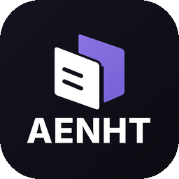
</p>

<h1 align="center">AENHT</h1>

<p align="center">
  <b>All E-Hentai + nhentai HenTai</b><br>
  在一个 App 里同时浏览 nhentai 和 E-Hentai / ExHentai 的非官方客户端<br>
  原生 iPhone / iPad（SwiftUI）+ 原生 Android（Jetpack Compose），逻辑层由 Kotlin Multiplatform 共享
</p>

<p align="center">
  <a href="https://github.com/AtlanYuey/AENHT/releases/latest">正式版下载</a> ·
  <a href="https://github.com/AtlanYuey/AENHT/releases/tag/dev-latest">最新修订</a> ·
  <a href="#功能一览">功能</a> ·
  <a href="#设计思路">设计思路</a> ·
  <a href="#使用方法">使用方法</a> ·
  <a href="#从源码构建">构建</a>
</p>

> [!WARNING]
> 当前版本 0.2.5，项目仍在积极开发中。仅供 18 岁以上用户使用。
> 本项目与 nhentai、E-Hentai 均无关联。

<p align="center">
  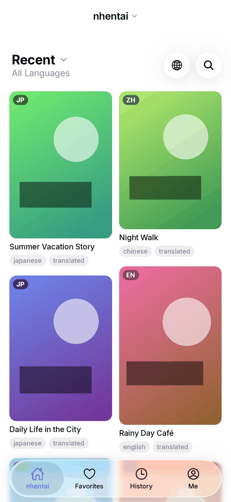
  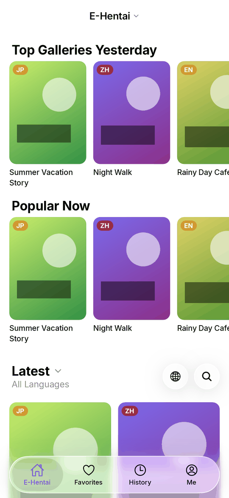
  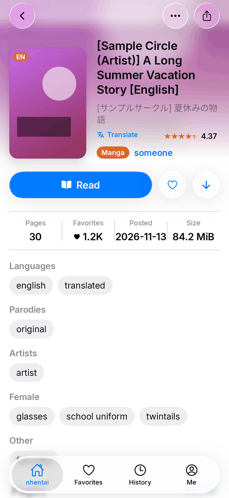
  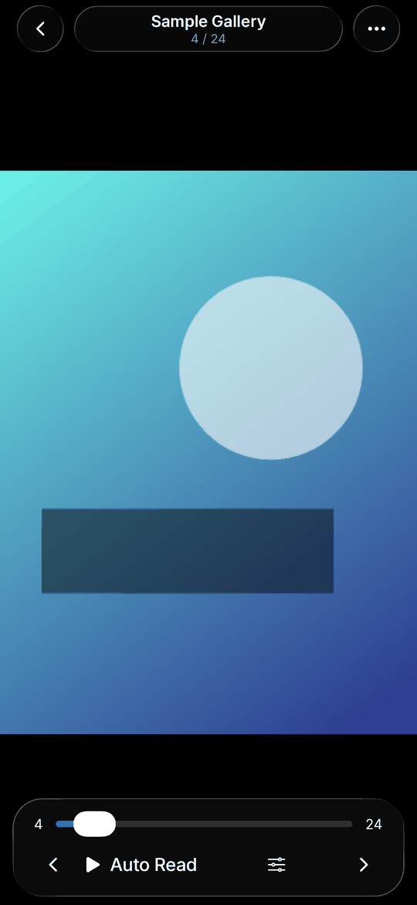
</p>

<p align="center"><sub>截图来自 Android 版的界面测试，封面和标题都是示例数据。iOS 版采用相同的主要布局。</sub></p>

---

## 为什么做 AENHT

原来浏览 nhentai 和 E-Hentai 需要两个 App：收藏在两处，历史在两处，设置要调两遍。AENHT 把两个站放进同一个 App：

- **一套界面，两个站点**：主页、搜索、作品页、阅读器在两个站上结构一致，换站不用重新熟悉。
- **合并的收藏、历史和下载**：两站内容按时间排在一起，每张卡片标明来自哪个站，也可以只看一个站。
- **原生体验**：iOS 用 SwiftUI（iOS 26 的 Liquid Glass），Android 用 Compose；不是网页套壳，也不是跨平台 UI。
- **共享的核心**：网络、网页解析、数据库、同步、翻译和限速都写在 Kotlin Multiplatform 里，两端行为一致，修一次就两端都修好。

## 功能一览

| | nhentai | E-Hentai / ExHentai |
| --- | :---: | :---: |
| 主页：最新 / 热门 / 排行榜 / 订阅 | ✅ 最新、今日 / 本周 / 本月 / 全部热门 | ✅ 最新、热门、订阅、四种排行榜 |
| 主页固定推荐行（最多两行） | ✅ | ✅ |
| 搜索、标签语法、搜索历史 | ✅ | ✅（切换站点自动转换语法） |
| 输入编号或粘贴链接直接打开 | ✅ 编号 | ✅ 作品链接 |
| 作品页：信息条、标签、页面缩略图、评论 | ✅ | ✅ 另有评分、种子、归档 |
| 其他版本（其他语言翻译 / 版本） | ✅ | ✅ |
| 相似作品 | ✅ | ✅ |
| 账号收藏同步到本地 | ✅ | ✅ 含 10 个收藏夹和备注 |
| 评论 | ✅ 发表 | ✅ 发表、投票、屏蔽评论者 |
| 账号 | ✅ 登录、API Key、多账号 | ✅ 网页登录、Cookie、里站、多账号 |
| 云端屏蔽 | ✅ 账号黑名单 | ✅ My Tags（站点页面） |
| 下载 | ✅ | ✅ 另有原图、官方归档 |
| 标签投票 / 添加标签 | — | ✅ |
| 图片配额与 GP | — | ✅ |

两站通用的功能：

- **阅读器**：四种方向、双页、自动裁边、自动翻页、连续模式自动滚动（可调速度）、超分辨率、点击区与滑动手势、屏幕常亮、亮度 / 灰度 / 反色。
- **平板**：iPad 和安卓平板横屏时，主页、作品页、「我的」可分别启用平板布局。
- **外接设备**：Apple Pencil（轻点两下、轻捏）、安卓手写笔（含 Galaxy S Pen 隔空操作）、Surface 等 Windows 笔、键盘和蓝牙翻页器都能翻页；设备连接或用过之后才显示对应设置。
- **翻译**：标签中文翻译；标题和评论可以用大模型、微软翻译或本机翻译。
- **过滤规则**：标签、标题、正则，两站共用。
- **同步**：WebDAV（iOS 与 Android 互通）；iOS 设置还可以走 iCloud。
- **隐私与安全**：应用锁、切到后台时模糊、诊断日志。
- **界面语言**：14 种。

## 截图

<table>
  <tr>
    <td align="center"><br><sub>nhentai 主页</sub></td>
    <td align="center"><br><sub>E-Hentai 主页与排行榜行</sub></td>
    <td align="center">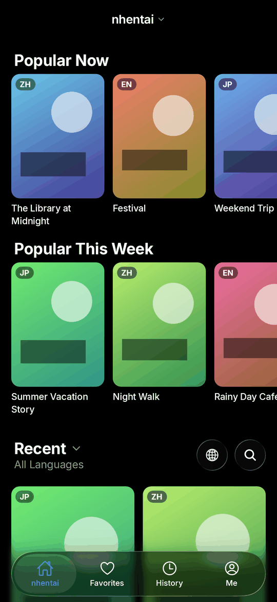<br><sub>深色模式与固定推荐行</sub></td>
    <td align="center">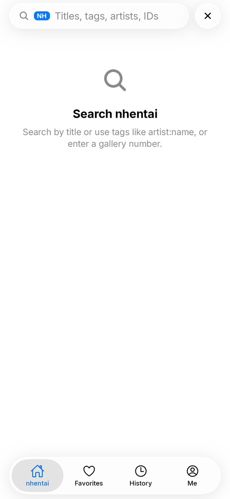<br><sub>搜索</sub></td>
  </tr>
  <tr>
    <td align="center">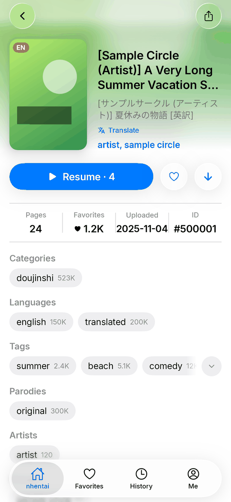<br><sub>作品页（nhentai）</sub></td>
    <td align="center"><br><sub>作品页（E-Hentai）</sub></td>
    <td align="center"><br><sub>阅读器</sub></td>
    <td align="center">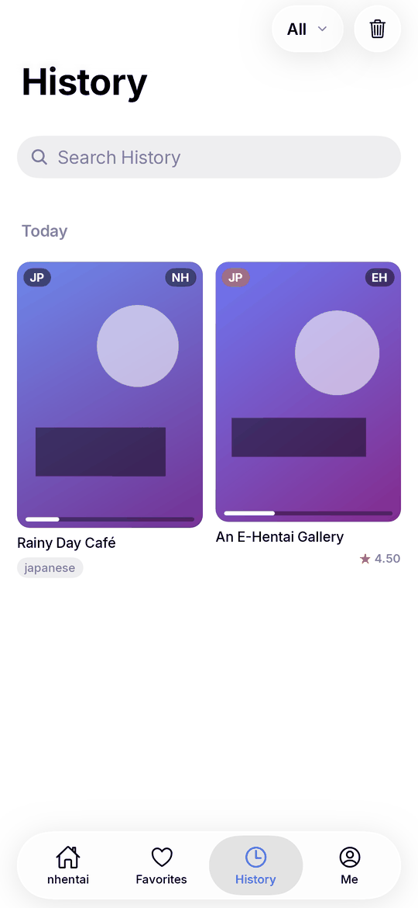<br><sub>两站合并的历史</sub></td>
  </tr>
  <tr>
    <td align="center">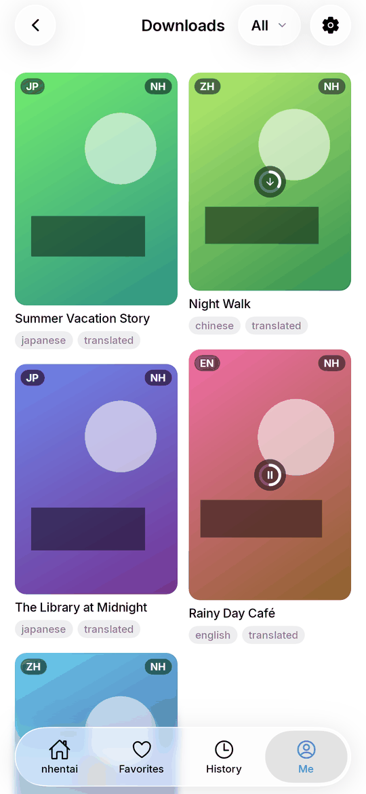<br><sub>下载</sub></td>
    <td align="center">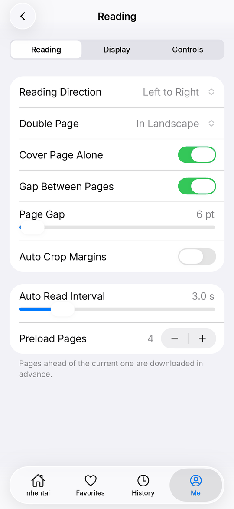<br><sub>阅读设置（三栏）</sub></td>
    <td align="center">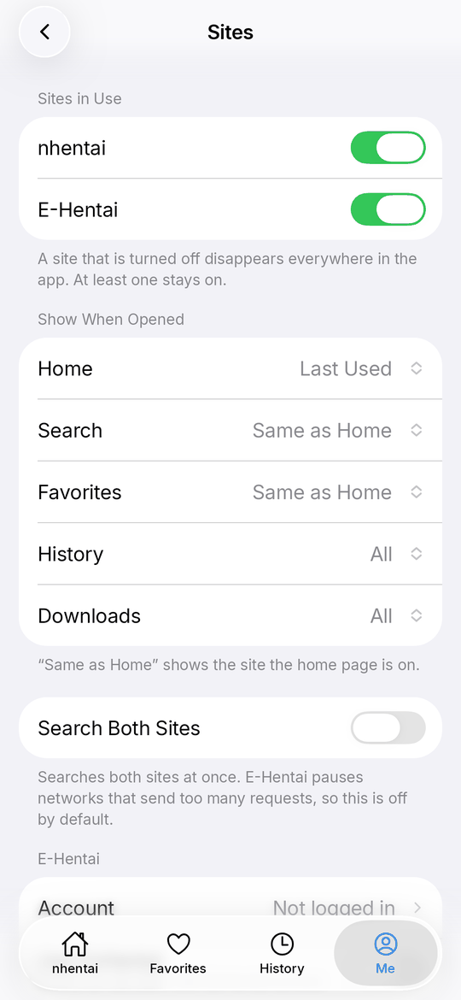<br><sub>站点设置</sub></td>
    <td align="center">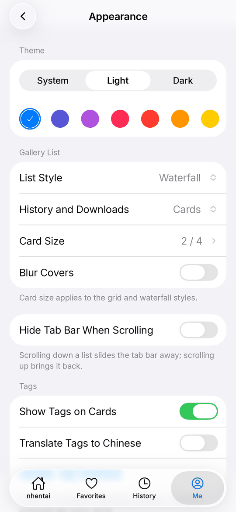<br><sub>外观</sub></td>
  </tr>
  <tr>
    <td align="center">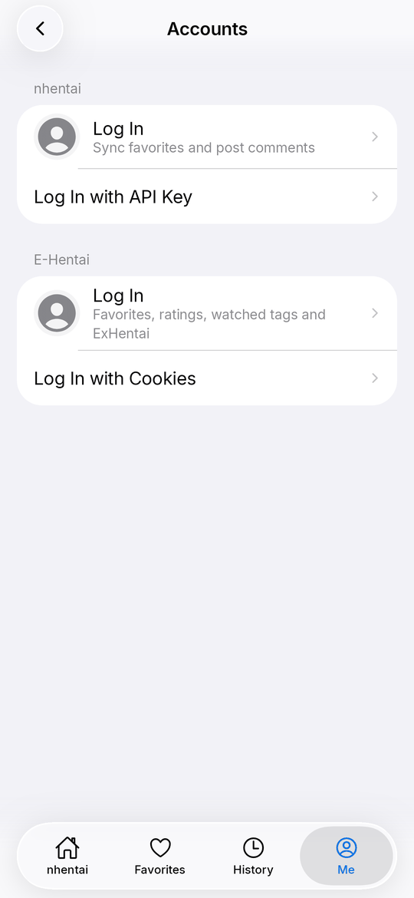<br><sub>账号</sub></td>
    <td align="center">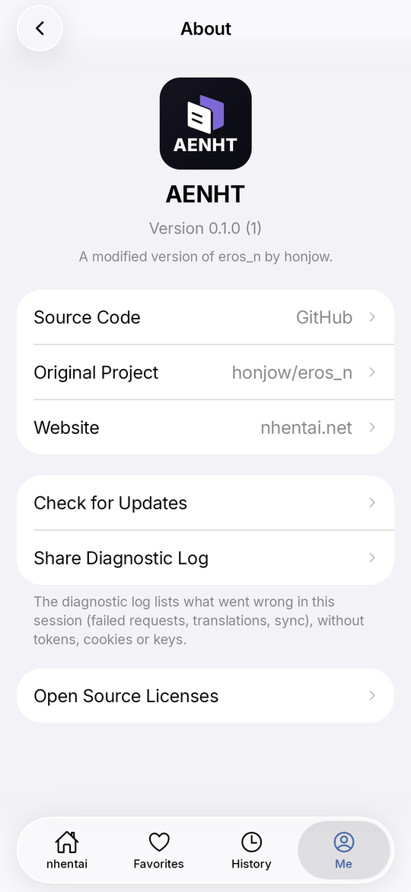<br><sub>关于</sub></td>
    <td align="center" colspan="2">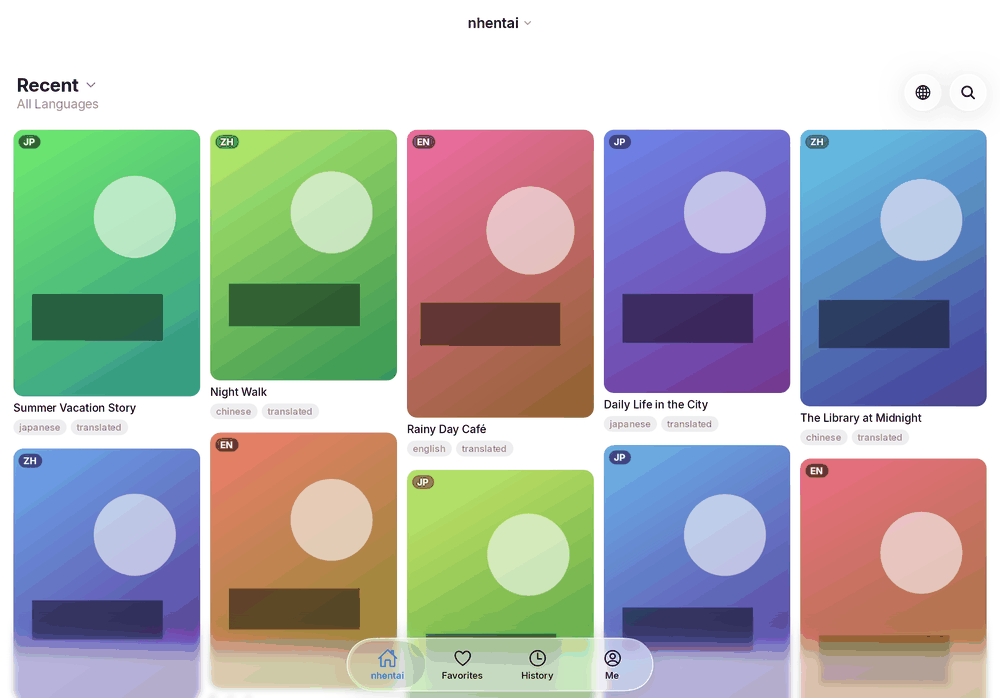<br><sub>平板横屏</sub></td>
  </tr>
</table>

## 设计思路

### 1. 一个 App，两个站，但只有一套界面

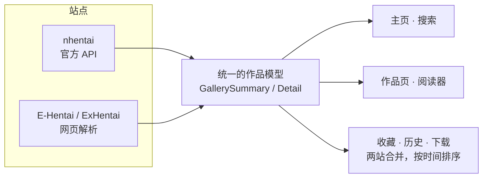

- 两站的数据先转换成同一种作品模型，界面只认这一种。所以两站的作品页都按同样的顺序排列：信息条 → 标签 → 页面 → 其他版本 → 相似作品 → 评论。各站独有的内容（E-Hentai 的评分、种子、归档）放在各自合适的位置，不打乱整体结构。
- ExHentai 不算一个单独的站点，而是 E-Hentai 下的「使用里站」开关（在「我的 › 站点」里紧挨 E-Hentai，开着 E-Hentai 时才显示），封面上标 EX。
- 每个分站点的页面都可以设置打开时显示什么：跟随上次、跟随主页、nhentai、E-Hentai 或全部，集中在「设置 › 站点」里。
- 卡片的配色约定：左上角的角标是语言，颜色跟作品分类（同人志、漫画等）走，两站用同一套分类色；在合并列表里，右上角标 NH 或 EH。

### 2. 顶部一次只显示一样东西

顶部空间有限，所以只放一行：

- 站点名在最上面正中，是一块液态玻璃按钮（白色粗体），点它切换站点；只开一个站点时不显示箭头。
- nhentai 的「随机作品」是右上角的骰子按钮。
- 下面一行是当前排序（例如「最新」），点它弹出菜单，副标题显示当前语言；右侧是语言和搜索两个圆形按钮。
- 往下滚动后，排序、语言和搜索会收进顶栏（替换掉骰子），回到顶部再放回原处。
- 顶栏的按钮都用白色（浅色模式下为黑色），不用强调色。
- 搜索在原地展开，不跳到新页面；站点切换放在搜索栏下面。
- 收藏页的标题本身就是菜单，点它在全部 / nhentai / E-Hentai 和各收藏夹之间切换。

### 3. 底栏的三段式点按

| 操作 | 主页 / 收藏 / 历史 | 我的 |
| --- | --- | --- |
| 点一下 | 回到顶部 | 返回上一层 |
| 再点一下 | 回到刚才的位置 | 继续返回 |
| 快速点两下 | 刷新 | — |

作品页的「页面」标题也是这样：点一下跳到第一张，再点一下回到刚才的位置。

iPad 上，底栏会跟着手移到你最后触摸的那一侧（快 / 中 / 慢三档），也可以固定在左、中、右。

### 4. 阅读器：进出都有连贯感

- 从作品页的缩略图打开阅读器时，图片从缩略图放大展开；关闭时缩回**当前读到的那一页**的缩略图，页面行（平板横屏时是右侧的页面栏）在阅读时就一直跟着当前页，关闭前已经停在那一页。
- 退出阅读器：从最左侧边缘向右拖，或者在左右翻页时上下拖动（按「滑动手势」设置），页面跟着手指缩小、露出作品页，松手前可以拖回来取消。放大时不会触发退出；Android 上放大时的返回手势会先把页面恢复原大小。
- 双击阅读器顶部的标题回到第一页（可以在「操作」里关闭）；阅读器里点状态栏不会跳回开头，点返回键时误触也不会跳走。
- 滑动手势和点击区自动配合：点击区在左右两侧时，上下滑动可以设成退出阅读器、显示控件或自动翻页；点击区在上下两侧时，改为左右滑动。和翻页同方向的滑动始终用来翻页，不会冲突。
- 屏幕常亮（默认 5 分钟）从最后一次触摸开始计时，结束后交还给系统自己的自动锁屏，**绝不会比系统更早熄屏**。
- 双页模式中间默认保留 6 pt 中缝；「页面间距」只在「上下连续（有间距）」模式下调整。
- 平板横屏时（「我的 › 平板模式适配」中逐项开关，iPad 和 Android 平板横屏时才显示这一项）：
  - **作品详细页**：左半边是作品信息；右侧可选「页面」或「其他版本、类似作品和评论」。选「页面」时，宽度可选正常二分或「三列」（缩略图大小不变，页面栏变窄）。关闭后和竖屏一样只有一栏。
  - **主页**：两行固定推荐左右并排；在两半交界处被切开的封面保持圆角。
  - **「我的」**：左右两栏，左边是列表，右边显示所选的页面，以及从它打开的二级、三级页面；默认显示「全部」：账号、下载、历史与收藏数、同步状态和版本。
- 转屏时列表在转屏动画里一次排好，停在原来看的那张卡片（iOS 的列表是 UICollectionView）。

### 5. 超分辨率：只在需要的时候做

- 在本机运行 Real-ESRGAN 动漫模型（iOS 用 Core ML，Android 用 ncnn）。
- 先显示原图，处理好后再换成清晰的版本，不用等。
- 「自动」模式只处理明显比可用显示区域小的页面。启用超分后，阅读器会优先处理当前页，也会提前处理符合条件的后续图片。
- 默认模型随 App 内置；更强的高质量模型可以在设置里另外下载。

### 6. 翻译：多级回退

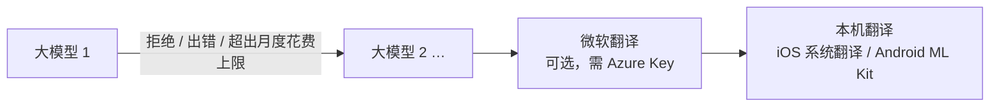

- 大模型服务的设置和 [AY Translate](https://github.com/AtlanYuey/AY_Translate) 一致：
  - 内置 9 个服务商：DeepSeek、Gemini、OpenAI、通义千问、硅基流动、Kimi、智谱、OpenRouter，以及任意兼容 OpenAI 的服务。
  - 粘贴 Key 后自动拉取模型列表。
  - 可以用测试短语试翻。
  - 可以选参数预设，也可以写自定义 JSON。
  - 可以设置单价和每月花费上限。
  - Key 只保存在本机钥匙串或加密存储里。
- 被换到下一个服务时，会提示「已切换到 X」。
- 标题翻译直接替换原标题，点一下换回原文。
- 标签翻译使用 EhTagTranslation 的中文数据库，每周自动更新；主页卡片上的标签也会翻译。

### 7. 尊重站点的规则

- 每个站点有一个全局限速器，按 nhentai 官方文档里各接口的限额，以及 E-Hentai 对请求频率的容忍度来设置。需要等待较久时，屏幕顶部会提示「x 秒后自动继续」。
- 限速是故意的设计，所以**不提供「解除限速」的开关**，这样可以避免 E-Hentai 封你的 IP。
- 「同时搜索两个站」默认关闭，原因相同。
- 下载可以设置并发数、重试次数和每页之间的间隔；E-Hentai 最多同时下载 3 页。

### 8. 隐私分级

切到后台时，App 切换器里显示什么，可以选：

| 选项 | 效果 |
| --- | --- |
| 模糊图片（默认） | 只模糊封面和页面 |
| 模糊图片和文字 | 另外模糊标题、标签、评论；设置页等界面元素保持清晰 |
| 模糊整个 App | 整个画面模糊 |
| 遮盖 App | 用纯色盖住 |

另有应用锁（Face ID / Touch ID / 指纹 / 设备密码），封面也可以常驻模糊。

## 功能详解

<details>
<summary><b>主页</b></summary>

- **nhentai**：最新、今日热门、本周热门、本月热门、全部时间热门。
- **E-Hentai**：最新、热门、订阅（Watched）、昨日 / 本月 / 本年 / 全部时间排行榜。
- **固定推荐行**：最多两行，显示在信息流上方。默认 nhentai 为「当前热门 + 本周热门」，E-Hentai 为「昨日排行榜 + 当前热门」。两行一起加载、一起出现。
- **列表样式**：瀑布流、紧凑瀑布流、网格、列表。卡片大小按横屏和竖屏分别设置，并随分屏和台前调度自动增减列数。
- 「随机作品」（nhentai，右上角骰子）、卡片上显示标签（可翻译）、按语言筛选。
</details>

<details>
<summary><b>搜索</b></summary>

- 默认搜索当前站点，可以开启「同时搜索两个站」。
- 切换站点时自动转换搜索语法；无法转换的条件会提示「不适用」。
- 只输入数字：上方显示该编号的 nhentai 作品，下方照常搜索。
- 粘贴 E-Hentai / ExHentai 作品链接：上方显示该作品。
- 回到 App 时识别剪贴板里的作品链接，并询问是否打开。
- 本地标签补全；搜索历史两站共用，每条标明站点（点按会回到那个站点搜索），可以关闭保存。
</details>

<details>
<summary><b>作品页</b></summary>

- **封面、标题与操作**：
  - 封面、标题、原文标题，并可翻译。
  - 作者、分类、评分（E-Hentai 显眼展示，可以评分）。
  - 阅读或「继续 · 第 N 页」、收藏、下载。
- **信息条**：页数、收藏数、发布时间、大小或编号。
- **标签**：按命名空间分组；点按搜索，长按复制。E-Hentai 还可以给标签投票、添加标签。
- **页面缩略图**：点「页面」标题可以跳到第一张，再点一次回到刚才的位置；「全部」靠右。
- **其他版本**：同一作品的其他语言翻译和其他版本。
- **相似作品**：nhentai 用官方推荐。E-Hentai 依次按作者 / 社团、原作 + 角色、主题组合搜索。
- **评论**：
  - 两站都可以发表。
  - E-Hentai 还支持投票、复制、屏蔽评论者。
  - 评论可以翻译，也会经过评论过滤。
- **E-Hentai 专属**：
  - 收藏夹选择与收藏备注。
  - 种子列表。
  - 官方归档下载（消耗 GP）。
  - 在浏览器打开。
</details>

<details>
<summary><b>阅读器</b></summary>

- **方向**：从左到右、从右到左、从上到下、连续（Webtoon），以及连续（有间距，可调）。
- **双页**：横屏时或始终；封面可单独成页；可以每次只翻一页（1–2、2–3、3–4…）；中间间距可开关，默认 6 pt，可调 2–60 pt。
- **自动裁边**：裁掉页面四周的白边。
- **自动翻页**：可以调间隔。
- **连续模式自动滚动**：速度可调；3 秒/屏及更快时显示红色速度提醒。速度设置下方提供“滑动时继续自动滚动”开关，默认关闭。
- **提前解码**：连续阅读会准备屏幕下方的两张图片，分页阅读会准备接下来的两面，双页模式最多四张。此功能默认启用，「预加载页数」单独控制提前下载的页数。
- **预加载**：提前下载当前页之后的若干页。
- **滑动翻页**：页面滑动（跟手），或渐变滚动（页面不动，柔和的渐变边缘跟着手指走，停下就停，快速一甩直接翻页）。
- **点击翻页**：页面滑动、整页渐变，或扩散渐变（从点击位置向外扩散）。两项可以自由组合；点击区可设为左右或上下。
- **页面大小**：双指放大后单指移动（有惯性），放大时不翻页、不退出；底部出现「重置大小」。分页模式可在「操作」里打开「允许缩小到小于屏幕」。连续模式默认显示一整页的宽度，双指可调宽窄，「保持页面大小」（默认开启）会记住调好的宽度。
- **滑动手势**：可以设为退出阅读器、显示 / 隐藏控件、开始 / 停止自动翻页，需要较长的滑动才触发。
- **屏幕常亮**：关、5 分钟、10 分钟、始终。
- **超分辨率**：关、自动、始终；可下载高质量模型。
- **页面滤镜**：亮度、灰度、反色，只作用于页面。
- **跳页与保存**：跳到指定页，保存或分享单页。
- **音量键翻页**（Android）。
- **键盘与蓝牙翻页器**：方向键、Page Up / Down、空格翻页（← → 跟随阅读方向），连续模式一次滚动一屏；连接时才在「操作」里显示设置，可交换上一页和下一页。
- **安卓手写笔**：笔身按键、第二按键、笔尾按键可分别设置动作（悬停按键，或 Android 14 以上蓝牙笔键）；Galaxy S Pen 支持隔空操作翻页；用过手写笔后才在「操作」里显示设置。
- **Windows 笔**（如 Surface 触控笔，蓝牙配对）：按一下笔尾按键翻下一页，按两下翻上一页。
- **Apple Pencil**（iPad）：笔离开屏幕时轻点两下、轻捏（Pro）翻页，动作可选；根据 iPad 型号和收到的手势判断是哪代笔。设置在「我的 › Apple Pencil」和「操作」里。
- **控制栏**：一段时间没有触摸后自动隐藏。底部只有一行：当前页、进度条、剩余页数；拖动进度条时显示前后几页的缩略图。阅读设置和自动阅读按钮悬浮在两侧，单个时跟随手的位置；也可以设为只有点击中间才呼出控制栏。
- **设置分三栏**：阅读（方向与双页、翻页方式、自动阅读、预加载）、显示（滤镜、页面大小、超分辨率、屏幕常亮）、操作（控制栏、点击与滑动、按键和设备）。
</details>

<details>
<summary><b>收藏</b></summary>

- 两站的账号收藏同步到本地数据库，在「全部」里按收藏时间合并显示，可以离线浏览。
- nhentai 不提供收藏时间：首次同步时保留原有顺序，之后新发现的收藏记录准确时间。
- 标题菜单：全部 / nhentai / E-Hentai。选 E-Hentai 时可以选 10 个收藏夹，并设置「全部」里显示哪些。
- 收藏和取消收藏立即生效，失败时自动恢复。支持搜索收藏。
- 切到「收藏」时自动刷新（可在「我的 › 网站」关闭），往下翻过时不刷新，保留位置。
- 多选移除：左上角「选择」或长按菜单里的「选择」，可全选；网站上的收藏也一起移除。
</details>

<details>
<summary><b>历史与下载</b></summary>

- **历史**：两站混在一起，按日期分组（今天、昨天……），可以按站点筛选和搜索，并显示阅读进度；可以多选删除（左上角「选择」或长按菜单）。
- **下载**：
  - 两站混在一起，按状态分组，支持多选、暂停、继续和删除。
  - 可以导出为 CBZ：分享，或保存到「文件」/ 下载目录。
- **下载设置**：同时下载的作品数和页数、重试次数、每页间隔、是否下载原图。
- 历史和下载都可以选卡片或列表样式。
</details>

<details>
<summary><b>账号</b></summary>

- 每个站点支持多个账号，点按即可切换。E-Hentai 没有头像，用「EH」字母头像表示。
- **nhentai**：账号登录，或者用 API Key 登录；可以使用账号的云端标签黑名单。
- **E-Hentai**：
  - 网页登录，或者用 Cookie 登录（里站需要 `igneous`，通常会自动获取）；复制的 Cookie 会自动识别并填入。
  - 检查里站权限。
  - 查看图片配额和重置所需的 GP。
  - 打开站点设置和 My Tags 页面。
</details>

<details>
<summary><b>过滤</b></summary>

- 两站共用一套规则，类型有标签、标题、正则表达式。标签规则忽略命名空间：nhentai 的 `tag:` 和 E-Hentai 的 `female:`、`male:` 等都能匹配。
- 命中规则的作品不会出现在两站的主页和搜索结果里。
- nhentai 账号的标签黑名单作为补充。
- **评论过滤**：被屏蔽的评论者在所有作品下都会隐藏。
</details>

<details>
<summary><b>同步、备份与其他</b></summary>

- **WebDAV**：同步设置、阅读历史和收藏副本，Android 和 iPhone 之间互通。支持 Nextcloud、NAS、坚果云（用应用密码）等。可以在打开和切到后台时自动同步。
  - 两台设备同时同步时，服务器支持 ETag 就不会互相覆盖：上传前确认文件没被别的设备改过，改过就合并后再传；一直在变时会提示「稍后再试」，不会强行覆盖。服务器不提供 ETag（少数简单服务器）时没有这层保护，请避免两台设备同一时刻同步。
  - 收藏副本只在登录后从网站完整读过一次才显示：从其他设备同步来的收藏会先隐藏，等本机读过网站上的收藏再显示，不会显示别的账号的收藏。
- **iCloud**（iOS）：设置跟随 Apple 账号同步。可以选择 iPad 与 iPhone 共享设置，或者只在同类设备之间同步；列数可以单独决定是否同步。
- **导出 / 导入设置**：存成文件，在另一台设备上导入。
- **备份范围**：Android 系统备份只包含设置；阅读历史和收藏副本只通过 WebDAV 同步保存，没有设置 WebDAV 时它们不会被备份。下载的文件只在本机。
- **检查更新**：显示最新版本和最新测试版。
- **诊断日志**：只记录本次运行中出错的请求、翻译和同步；写入时会去掉已知格式的 Token、Cookie、Key 和密码。分享前仍建议看一眼内容。
- **外观**：
  - 跟随系统、浅色、深色。
  - 多种强调色。
  - 滚动时隐藏顶栏和底栏（也可以只把底栏缩成一个小按钮）。
- **界面语言**：简体中文、繁体中文、英语、日语、韩语、西班牙语、法语、德语、意大利语、葡萄牙语（巴西）、俄语、越南语、泰语、印尼语，可以只给本 App 单独设置。
</details>

## 使用方法

### 安装

正式版在 [Releases](https://github.com/AtlanYuey/AENHT/releases/latest)。想尝鲜的话，最新测试版在 [dev-latest](https://github.com/AtlanYuey/AENHT/releases/tag/dev-latest)，每次推送代码后自动更新。「关于 › 检查更新」会同时显示这两种版本。

| 平台 | 文件 | 要求 |
| --- | --- | --- |
| Android | `.apk` | Android 10 及以上 |
| iPhone / iPad | `.ipa` | iOS / iPadOS 18 及以上（推荐 26） |

- **Android**：下载 APK 后直接安装。正式版使用固定证书签名，以后可以直接覆盖升级；如果装过 0.1.0 之前的测试版，需要先卸载一次。
- **iOS**：IPA 未签名。请用 AltStore、SideStore、Sideloadly 等工具，以自己的 Apple ID 签名后安装。

### 第一次使用

1. 打开后默认显示 nhentai 主页。点最上面的站点名可以切换到 E-Hentai。
2. 在「我的 › 站点」里选择启用哪些站点，以及每个页面打开时显示什么。
3. 登录（可选）。不登录也能浏览、搜索、阅读和下载；收藏、评论和里站需要登录：
   - **nhentai**：「我的 › 账号 › nhentai › 登录」，或者在 nhentai.net › Settings › API Keys 创建 Key，然后选「用 API Key 登录」。
   - **E-Hentai**：「我的 › 账号 › E-Hentai › 登录」。如果网页登录失败，从已登录的浏览器复制 `ipb_member_id`、`ipb_pass_hash`（里站还需要 `igneous`），然后选「用 Cookie 登录」：复制的内容会被自动识别并填好（Cookie 请求头、Cookie 扩展导出的 JSON 或 cookies.txt 都可以，一次复制全部即可）。
   - **ExHentai**：账号有里站权限时，在「我的 › 账号 › E-Hentai」或「我的 › 站点」里打开「使用里站」。

### 设置翻译

1. **标签翻译**：「外观 › 将标签翻译为中文」。
2. **标题和评论翻译**：「我的 › 翻译 › 添加 AI 服务」。
   1. 选择服务商，粘贴 API Key，模型列表会自动加载。
   2. 点「测试翻译」确认可用。
   3. 可以添加多个服务，在「使用顺序」里拖动排序。
3. **没有 Key 时**：自动使用本机翻译。第一次翻译某种语言时，系统会下载语言包，iOS 由系统提示下载，Android 每种语言约 30 MB。

### 设置同步

- **WebDAV**：「我的 › WebDAV 同步」，填写服务器地址、用户名和密码，然后点「连接」。数据保存在服务器的 `AENHT` 文件夹里。
- **iCloud（iOS）**：「我的 › iCloud 同步」。需要签名时带 iCloud 能力，侧载签名通常不带，这种情况下可以改用「导出 / 导入设置」。

### 手势速查

| 位置 | 操作 | 效果 |
| --- | --- | --- |
| 底栏 | 点一下 / 再点一下 / 快速点两下 | 回到顶部 / 回到原位置 / 刷新 |
| 作品页「页面」 | 点一下 / 再点一下 | 第一张 / 回到原位置 |
| 作品标题（已翻译） | 点一下 | 在译文和原文之间切换 |
| 标签 | 点按 / 长按 | 搜索该标签 / 复制 |
| 评论（E-Hentai） | 长按 | 投票、复制、屏蔽评论者 |
| 阅读器 | 点击区 | 翻页；中间显示控件 |
| 阅读器 | 长滑动（垂直于翻页方向） | 按设置：退出、显示控件、自动翻页 |
| 阅读器 | 双指缩放、双击 | 放大页面（放大后单指移动）；底部「重置大小」恢复 |
| 阅读器 | 左边缘向右拖 / 上下拖（左右翻页时） | 跟手退出，可拖回取消 |
| 阅读器 | 双击顶部标题 | 回到第一页 |
| 阅读器（iPad） | Apple Pencil 轻点两下 / 轻捏 | 下一页 / 上一页（可设置） |
| 阅读器 | 键盘、翻页器：→ ↓ 空格 / ← ↑ | 下一页 / 上一页 |

## 项目结构

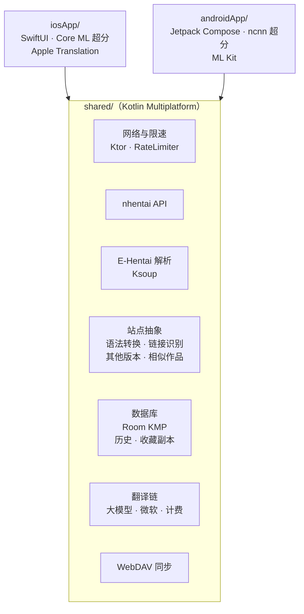

| 目录 | 内容 |
| --- | --- |
| `shared/` | 共享层：网络、站点抽象、解析、数据库、同步、翻译、限速，以及对应的单元测试 |
| `androidApp/` | Android App（Kotlin、Jetpack Compose），含 Roborazzi 界面截图测试 |
| `iosApp/` | iOS / iPadOS App（SwiftUI），Xcode 工程由 XcodeGen 生成 |
| `models/sr/` | 超分辨率的高质量模型（ncnn 与 Core ML） |
| `tools/` | 多语言文案生成（`i18n/`）、图标渲染（`icon/`）、模型转换（`sr/`） |
| `design/` | 图标设计稿 |
| `docs/` | 需求记录、iOS 签名说明、README 图片 |

主要依赖：Kotlin 2.4、Ktor 3、Room KMP、Ksoup、kotlinx.serialization、Compose、Coil 3、Nuke。

## 从源码构建

**Android**（需要 JDK 21 和 Android SDK）：

```bash
./gradlew :androidApp:assembleDebug
```

**iOS**（需要 macOS 和 Xcode 26；Xcode 的构建步骤会自动调用 Gradle 编译共享框架）：

```bash
cd iosApp && xcodegen generate && open AENHT.xcodeproj
```

**测试**：

```bash
./gradlew :shared:jvmTest :androidApp:testDebugUnitTest
```

界面截图测试的输出在 `androidApp/build/screens/`。

**CI**：推送到 `main` 或 `dev` 时，GitHub Actions 会构建 APK 和 IPA。`dev` 的构建会更新 `dev-latest` 预发布。在 GitHub 上发布一个 Release 时，会按它的标签自动构建，并把正式签名的 APK 和未签名的 IPA 附加到这个 Release 上，不需要手动上传。IPA 的签名方法见 [docs/ios-signing.md](docs/ios-signing.md)。

## 路线图

- [x] 两站浏览、搜索、阅读、下载
- [x] 合并的收藏、历史、下载
- [x] 大模型 / 微软 / 本机翻译（标题、评论）与标签翻译
- [x] 超分辨率第一期（Real-ESRGAN 动漫模型）
- [x] WebDAV 与 iCloud 同步
- [x] iPad 与安卓平板布局
- [x] Apple Pencil、安卓手写笔、Windows 笔、键盘与翻页器翻页
- ❌ **漫画页面翻译（识别图中文字并翻译）：暂不考虑。** 整本漫画翻译的 Token 消耗过大。iPhone / iPad 可以使用 [AY-Translate](https://github.com/AtlanYuey/AY_Translate)，通过截图仅识别、翻译当前页。
- [ ] 不登录也能使用的本地收藏
- [ ] 从 AEros-NHT 导入数据
- [ ] 收藏「全部」按发布时间排序

## 许可与致谢

- **许可**：基于 Apache License 2.0 发布（见 [LICENSE](LICENSE) 与 [NOTICE](NOTICE)），由 [AtlanYuey](https://github.com/AtlanYuey) 维护。与 nhentai、E-Hentai 及下面各项目的作者均无关联。
- **参考项目**（App 内「关于 › 参考项目」）：
  - [eros_n](https://github.com/honjow/eros_n)（honjow）：AENHT 最初的起点。
  - [AEros-NHT](https://github.com/AtlanYuey/AEros-NHT)：本应用的早期版本。
  - [NextE](https://github.com/erosTeam/NextE) 与 [NextN](https://github.com/erosTeam/NextN)（erosTeam，MIT）：E-Hentai 与 nhentai 功能的行为参考，没有复制其源码。
  - [AY Translate](https://github.com/AtlanYuey/AY_Translate)：AI 翻译服务的设置。
  - [nhentai_tags_fetcher](https://github.com/honjow/nhentai_tags_fetcher)（honjow）：nhentai 标签数据。
  - [EhTagTranslation](https://github.com/EhTagTranslation/Database)（CC BY-NC-SA 3.0）：标签的中文翻译。
- **图标与模型**：
  - AI 服务商图标来自 [LobeHub Icons](https://github.com/lobehub/lobe-icons)（MIT）。
  - 超分辨率模型来自 [Real-ESRGAN](https://github.com/xinntao/Real-ESRGAN)（BSD-3-Clause）。
- App 内「关于 › 开源许可」列出了用到的主要第三方库、数据和模型的许可。

仅供 18 岁以上用户使用。
